<p align="center">
  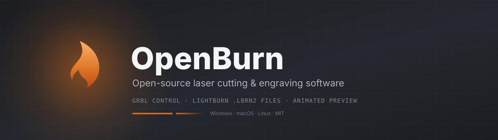
</p>

<h1 align="center">OpenBurn</h1>

<p align="center">
  Software libre de <strong>corte y grabado láser</strong> para máquinas GRBL.<br/>
  Diseña, previsualiza la trayectoria y lanza el trabajo — con importación y
  exportación nativa de <code>.lbrn</code> / <code>.lbrn2</code>.
</p>

<p align="center">
  <a href="https://openburn.pages.dev"></a>
  <a href="https://github.com/SJLS27/openburn/releases/latest"></a>
  <a href="https://github.com/SJLS27/openburn/actions/workflows/ci.yml"></a>
  <a href="LICENSE"></a>
  
  
  
  
</p>

<p align="center">
  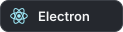
  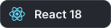
  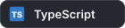
  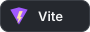
  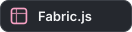
  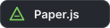
  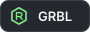
  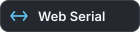
  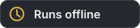
</p>

<p align="center">
  <a href="README.md">English</a> ·
  <strong>Español</strong> ·
  <a href="https://openburn.pages.dev/es/">Web</a> ·
  <a href="#capturas">Capturas</a> ·
  <a href="#inicio-rápido">Inicio rápido</a>
</p>

<p align="center">
  <a href="https://github.com/SJLS27/openburn/releases/latest"><b>Descargar la última versión</b></a> ·
  <a href="docs/USAGE.md">Guía de uso</a> ·
  <a href="https://openburn.pages.dev/es/">openburn.pages.dev/es</a>
</p>

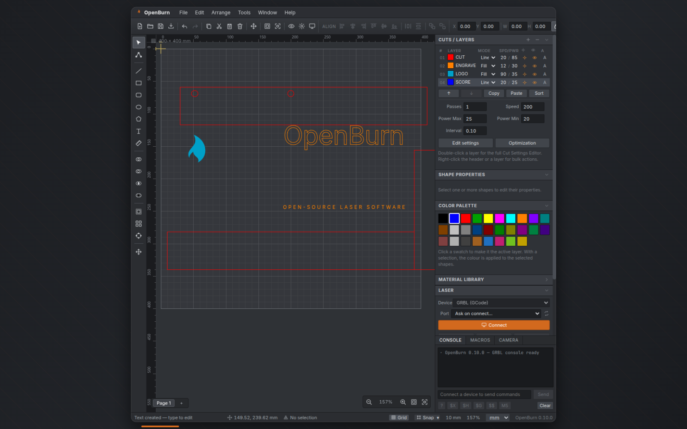

---

## ¿Por qué OpenBurn?

- **Una alternativa real a LightBurn, no una maqueta.** Vectores, capas,
  booleanos, texto a contornos, grabado de imágenes, planificación de corte,
  preview y envío a GRBL ya funcionan de extremo a extremo.
- **Tus archivos `.lbrn2` son bienvenidos.** Abre un proyecto de LightBurn,
  conserva sus capas y ajustes de corte, edítalo aquí y vuelve a exportarlo.
- **Habla con la máquina, no con la nube.** GRBL por Web Serial y un simulador
  integrado para ensayar un trabajo sin láser.
- **Libre, MIT y sin conexión.** Sin cuenta, sin telemetría, sin anuncios. Tus
  diseños no salen de tu ordenador.

## Novedades de la 0.10

- **Edición de nodos completa**: arrastra las asas de Bézier, haz doble clic en
  un segmento para añadir un nodo, borra nodos, cambia entre esquina / suave /
  simétrico y entre recta y curva.
- **Snapping a objetos**: vértices, centros, puntos medios e intersecciones, con
  guías de alineación al arrastrar y radio de captura configurable.
- **Reglas y medidas en vivo** alrededor del lienzo: `W × H`, `ΔX`/`ΔY`, ángulo y
  longitud al mover, escalar o rotar.
- **Alineación de texto** (izquierda / centro / derecha), también dentro de
  grupos, respetada por las exportaciones a GCode y LightBurn.
- **Los campos de forma operan sobre el bounding box real**, con candado de
  proporción que también se aplica al arrastrar esquinas.
- **Preview mucho más fluido** gracias a capas cacheadas de fondo, trazos y
  raster.

Detalle completo en [CHANGELOG.md](CHANGELOG.md).

---

## Capturas

<table>
  <tr>
    <td width="50%" align="center">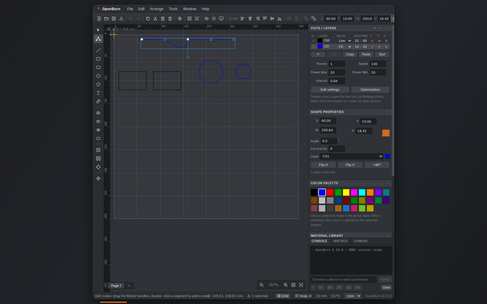<br/><sub><strong>Edición de nodos</strong> — asas, tipos de nodo y snapping</sub></td>
    <td width="50%" align="center">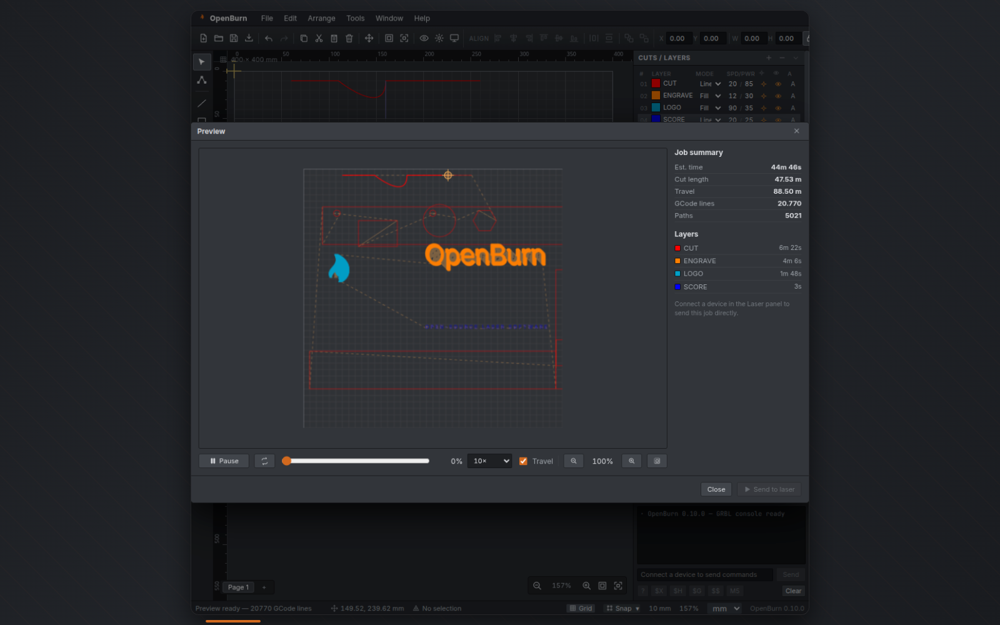<br/><sub><strong>Preview</strong> — trayectorias, tiempos y estadísticas por capa</sub></td>
  </tr>
  <tr>
    <td width="50%" align="center">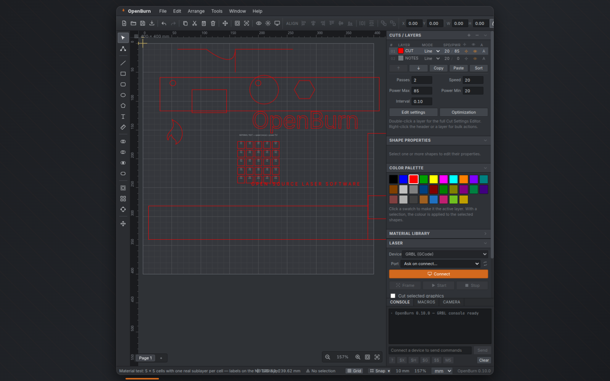<br/><sub><strong>Material Test</strong> — potencia × velocidad con subcapas reales</sub></td>
    <td width="50%" align="center">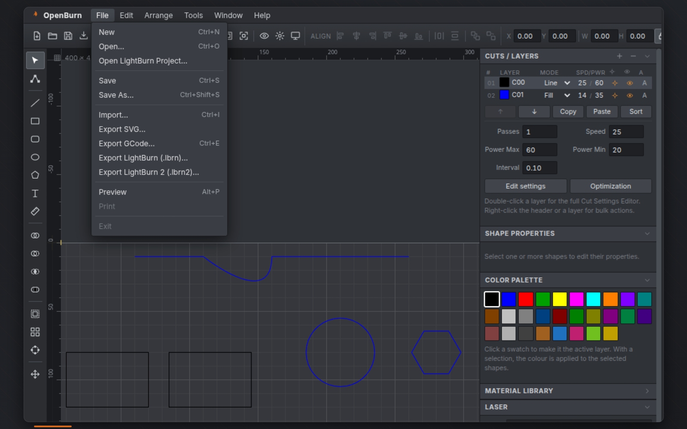<br/><sub><strong>LightBurn</strong> — abrir y exportar .lbrn / .lbrn2</sub></td>
  </tr>
  <tr>
    <td width="50%" align="center">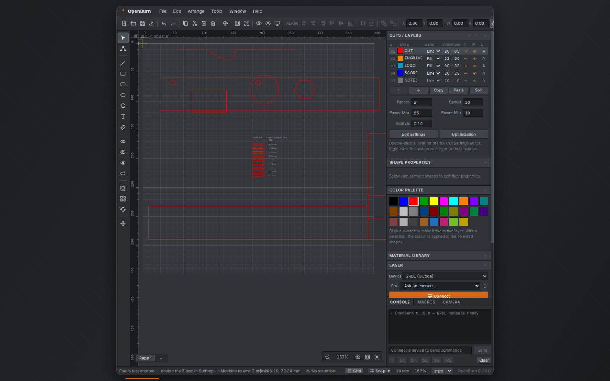<br/><sub><strong>Focus Test</strong> — rampa de Z para encontrar el foco</sub></td>
    <td width="50%" align="center">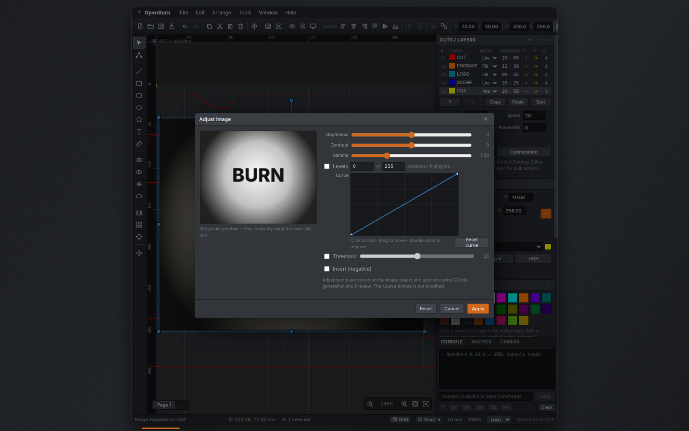<br/><sub><strong>Adjust Image</strong> — niveles, curvas y preview en vivo</sub></td>
  </tr>
</table>

---

## Características

### Diseño vectorial
- Herramientas de línea, rectángulo, rectángulo redondeado, elipse, polígono,
  texto y medida.
- Selección, mover, escalar, rotar, voltear, alinear, distribuir, agrupar y
  ordenar.
- **Booleanos** (unión, resta, intersección, exclusión) con Paper.js.
- **Offset**, arrays en cuadrícula/circulares y **edición de nodos** completa
  (añadir y borrar nodos, asas de Bézier, recta ↔ curva, esquina / suave /
  simétrico).
- **Snapping** a rejilla, vértices, centros, puntos medios e intersecciones, con
  guías de alineación.
- **Texto a contornos** con opentype.js (Inter incluida) para cortar o grabar
  sin depender de fuentes instaladas.
- **Add Tabs**: puentes para que las piezas no se suelten, y **pegado desde el
  portapapeles del sistema** (texto, SVG —incluido el comprimido de Inkscape— e
  imágenes).

### Capas y ajustes de corte
- Paleta tipo LightBurn (`C00`, `C01`, …): cada color es una capa.
- **Panel Cuts / Layers** con modo, velocidad/potencia, output, show y aire,
  reordenación de capas, menús contextuales y campos rápidos de pasadas,
  velocidad, potencia e intervalo.
- **Cut Settings Editor** con pestañas Common/Advanced: potencia mínima, pausas,
  overcut, lead-in/lead-out, Z offset y Z step por pasada.
- Modos **Line**, **Fill**, **Offset Fill** e **Image** con overscan,
  bi-direccional, cross-hatch, flood fill y ramp.
- **Modos de grabado de imagen**: Threshold, Ordered, Atkinson, Dither, Stucki,
  Jarvis, Newsprint, Halftone, Sketch y Grayscale, con Negative, corrección de
  ancho de punto, incremento de ángulo y pass-through.
- **Compensación de kerf** por capa, ángulo de scan, cross-hatch y scan offset.
- Trazos **hairline** que se mantienen a 1 px con cualquier zoom.
- **Biblioteca de materiales editable** (nombre, espesor, velocidad, potencia,
  pasadas, modo y kerf) y overrides de corte por objeto.

### Preview y GCode
- GCode GRBL generado por capas, con mapeo de origen y `M3`/`M4`.
- **Preview animado** con scrub, velocidad, cabeza láser, tiempo estimado y
  estadísticas por capa.
- **Recorrido de máquina visible**, como LightBurn.
- **Planificador de corte tipo LightBurn** (Optimization Settings): orden por
  capa, grupo o prioridad, interiores primero, orden por dirección, reducción de
  viajes, mejor punto de inicio, esquinas preferidas, optimización de dirección
  y eliminación de líneas solapadas.
- Exportación a GCode (`.nc`) y LightBurn (`.lbrn` / `.lbrn2`).

### Control GRBL
- Conexión por **Web Serial** o con el **simulador integrado** (sin hardware).
- Streaming con control de flujo, `Frame`, `Start`, `Pause/Resume` y `Stop`.
- Jog (`$J`), homing (`$H`), unlock (`$X`) y fijar origen (`G10 L20`).
- Consola bidireccional y macros persistentes.
- Estado en vivo: posición, feed, spindle, progreso y tiempo restante.

### Calibración
- **Material Test** (potencia × velocidad con subcapas reales), **Interval
  Test**, **Focus Test** con rampa de Z y **Kerf Test**.
- **Biblioteca de materiales** guardable y reutilizable con un clic, incluido el
  kerf medido.
- Eje **Z** configurable: offsets por objeto y movimientos `G1 Z` en el GCode.

### Imágenes
- Importación de PNG, JPG, GIF, BMP y WebP.
- **Adjust Image**: brillo, contraste, gamma, niveles, curva de tonos, umbral e
  invertir, con previsualización en vivo.
- **Trace Image**: vectorización monocroma o color con control de umbral y
  detalle, preview antes de aplicar y opción de una capa por color.
- **Apply Mask to Image**: recorta una imagen con una forma vectorial.

### Flujo de escritorio
- **Autoguardado** y recuperación del trabajo sin guardar tras un cierre
  inesperado.
- **Pantalla de bienvenida** con nuevo, abrir y recientes.
- **Archivos recientes**, drag & drop de proyectos/SVG/DXF/imágenes en el punto
  donde se sueltan, tamaño de ventana persistente e historial acotado.
- **Auto-update**: comprobación al arrancar, descarga en segundo plano y
  **Restart & install**.

### Compatibilidad LightBurn
- **Abre** proyectos `.lbrn` y `.lbrn2`: rectángulos, elipses, polígonos, paths
  con Bézier, grupos, texto con backup path, bitmaps y cut settings.
- **Exporta** ambos formatos con geometría, texto en contornos, bitmaps y capas.

---

## Inicio rápido

### Requisitos
- Node.js **22.22+** y npm **10+** (solo para desarrollo)
- Linux, macOS o Windows
- Opcional: máquina GRBL conectada por USB/serie

### Instalación

**AppImage (Linux x64)** — descárgala de la
[última release](https://github.com/SJLS27/openburn/releases/latest):

```bash
chmod +x OpenBurn-*.AppImage
./OpenBurn-*.AppImage
```

Los builds de **Windows** (instalador NSIS) y **macOS** (DMG/ZIP) se publican en
la misma página de releases. **Flatpak**: el manifiesto y las fuentes offline
están en [`flatpak/`](flatpak/README.md); la publicación en Flathub está
pendiente de revisión.

**Compilar desde el código:**

```bash
git clone https://github.com/SJLS27/openburn.git
cd openburn
npm install
npm run dev            # navegador con recarga en caliente
npm run dev:electron   # app de escritorio (Electron + Vite)
npm run build:app      # instalador: AppImage / NSIS / DMG
```

### Primer trabajo
1. Elige **New Design** u **Open Project** en la pantalla de bienvenida, o
   arrastra un `.obrn`, `.lbrn2`, SVG, DXF o una imagen al lienzo.
2. Elige una herramienta en la barra izquierda y dibuja.
3. Asigna color/capa en la paleta y ajusta velocidad y potencia en
   **Cuts / Layers**.
4. Pulsa **Preview** (`Alt+P`) para revisar trayectorias y tiempos.
5. En el panel **Laser**, conecta tu GRBL o el **Simulator** y pulsa **Start**.
6. Guarda como `.obrn` (`Ctrl+S`) o exporta a LightBurn / GCode desde **File**.

> **Formato nativo:** `.obrn`. Los proyectos antiguos `.ovbrn` se pueden abrir y
> se convierten a `.obrn` al guardar.

### Atajos principales

| Acción | Atajo |
| --- | --- |
| Nuevo / Abrir / Guardar | `Ctrl+N` / `Ctrl+O` / `Ctrl+S` |
| Importar artwork / Exportar GCode | `Ctrl+I` / `Ctrl+E` |
| Deshacer / Rehacer | `Ctrl+Z` / `Ctrl+Shift+Z` (`Ctrl+Y` también) |
| Copiar / Cortar / Pegar / Duplicar | `Ctrl+C` / `Ctrl+X` / `Ctrl+V` / `Ctrl+D` |
| Pegar en su sitio | `Alt+V` |
| Seleccionar todo / Eliminar | `Ctrl+A` / `Supr` |
| Agrupar / Desagrupar | `Ctrl+G` / `Ctrl+U` |
| Voltear horizontal / vertical | `H` / `V` |
| Rotar 90° horario / antihorario | `.` / `,` |
| Espejo respecto a una línea / rotar por dos puntos | `Ctrl+Shift+M` / `Ctrl+2` |
| Herramientas | `S` seleccionar · `N` nodos · `L` línea · `R` rectángulo · `E` elipse · `P` polígono · `T` texto · `M` medir |
| Preview | `Alt+P` |
| Zoom a página / a selección | `Ctrl+0` / `Ctrl+Shift+A` |
| Zoom in / out | `+` / `-` |
| Paneo | `Espacio` + arrastrar, o botón central |
| Pegar desde el sistema (con portapapeles interno lleno) | `Ctrl+Shift+V` |

---

## Compatibilidad con LightBurn

OpenBurn lee y escribe el formato XML de LightBurn sin usar su código original.

**Abrir:** *File → Open LightBurn Project…* o *File → Open…* con un
`.lbrn`/`.lbrn2`. Se importan capas, colores, geometría, grupos, contornos de
respaldo del texto, imágenes y ajustes de corte.

**Exportar:** *File → Export LightBurn (.lbrn)…* (legado, XML legible) o
*File → Export LightBurn 2 (.lbrn2)…* (compacto, actual).

**Límites**
- Los colores de capa en LightBurn dependen del índice de la capa; los colores
  personalizados de OpenBurn se muestran con el color de la paleta allí.
- Los grupos se aplanan al exportar.
- Los overrides por objeto (material tests) se exportan como ajustes de capa.
- Las imágenes rotadas se exportan sin rotación (con aviso).
- El texto se exporta en contornos y el importado usa sus contornos de respaldo.

Más detalles en [docs/FILE-FORMATS.md](docs/FILE-FORMATS.md). Si un proyecto no
abre, [abre un issue](https://github.com/SJLS27/openburn/issues) con el archivo
(o una copia anonimizada).

---

## Arquitectura

```
openburn/
├─ electron/           # proceso principal, preload y auto-update (IPC, diálogos, assets)
├─ src/
│  ├─ core/            # documento .obrn, unidades, DXF, acceso a archivos
│  ├─ geometry/        # booleanos, offset y tabs (Paper.js)
│  ├─ gcode/           # planificación, optimización y generación de GCode
│  ├─ image/           # ajuste de imagen y vectorización
│  ├─ io/              # import/export LightBurn (.lbrn/.lbrn2)
│  ├─ serial/          # transportes, controlador GRBL y simulador
│  ├─ state/           # store observable + API del workspace
│  ├─ text/            # texto a contornos (opentype.js)
│  ├─ types/           # modelo de documento y tipos
│  ├─ ui/              # menús, toolbars, paneles, diálogos e iconos
│  └─ workspace/       # controlador Fabric.js (herramientas, historial)
├─ e2e/                # tests end-to-end (Playwright + Electron)
├─ public/fonts/       # Inter (OFL) para los contornos
└─ docs/               # documentación, capturas y recursos de marca
```

El documento vive en un **store observable**, el lienzo en **Fabric.js**, la
geometría de mecanizado en **Paper.js** y los trabajos los envía un
**controlador GRBL** con transporte intercambiable (Web Serial o simulador).

Más en [docs/ARCHITECTURE.md](docs/ARCHITECTURE.md).

---

## Documentación

| Documento | Contenido |
| --- | --- |
| [docs/USAGE.md](docs/USAGE.md) | Guía de uso: diseño, capas, preview, GRBL, tests, imágenes y tabs |
| [docs/FILE-FORMATS.md](docs/FILE-FORMATS.md) | `.obrn` y mapeo detallado `.lbrn`/`.lbrn2` |
| [docs/ARCHITECTURE.md](docs/ARCHITECTURE.md) | Módulos, flujo de datos y pipeline de GCode |
| [docs/DEVELOPMENT.md](docs/DEVELOPMENT.md) | Entorno, scripts, pruebas y empaquetado |
| [website/README.md](website/README.md) | Web pública: contenido bilingüe, Cloudflare Pages y Search Console |
| [CHANGELOG.md](CHANGELOG.md) | Novedades por versión |
| [AGENTS.md](AGENTS.md) | Política de tests, convenciones y checklist para agentes/contribuidores |
| [TODO.md](TODO.md) | Lista de tareas y roadmap |

### Contribuir
Los issues y pull requests son bienvenidos — ver
[CONTRIBUTING.md](CONTRIBUTING.md). Todo cambio debe mantener en verde
`npm run typecheck`, `npm run test` y `npm run build`; las features nuevas llegan
con tests ([AGENTS.md](AGENTS.md)).

---

## Roadmap

- [x] **Auto-update** — comprobación al arrancar, descarga en segundo plano,
  aviso de reinicio y publicación automática en GitHub Releases
- [x] **Testing** — Vitest + Testing Library, Playwright/Electron, CI y política
  en [AGENTS.md](AGENTS.md)
- [x] Núcleo de diseño vectorial y capas
- [x] Preview, GCode y control GRBL
- [x] Texto a contornos, tests Material/Interval/Focus, imágenes, tabs y planner
- [x] Kerf, cross-hatch, scan offset, biblioteca de materiales, eje Z y Kerf Test
- [x] Compatibilidad LightBurn (lectura y escritura `.lbrn`/`.lbrn2`)
- [x] **Fundamentos de escritorio** — autoguardado y recuperación, recientes,
  pantalla de bienvenida, drag & drop, ventana persistente e historial acotado
- [x] **Edición de nodos y snapping**
- [ ] **Varios documentos** — pestañas/ventanas con store multi-documento
- [ ] Rotary, cámaras y Print & Cut
- [ ] Controladores Ruida/DSP y galvo (EZCad)
- [ ] Paquetes firmados (certificados Windows/macOS)
- [ ] **Migración a Tauri (exploración)** — evaluar una capa de escritorio
  alternativa (Rust + webview) para reducir el tamaño del instalador y el consumo
  de memoria; idea abierta, sin versión asignada

Estado y detalle en [TODO.md](TODO.md).

---

## Licencia y créditos

- Código: **MIT** — ver [LICENSE](LICENSE).
- **Apoyar el proyecto:** [PayPal](https://paypal.me/openburn) ·
  [página de apoyo](https://openburn.pages.dev/support/) (sin anuncios ni cookies).
- Fuente **Inter**: SIL Open Font License 1.1 —
  [public/fonts/Inter-LICENSE.txt](public/fonts/Inter-LICENSE.txt).
- [Fabric.js](https://github.com/fabricjs/fabric.js) (MIT),
  [Paper.js](https://github.com/paperjs/paper.js) (MIT),
  [opentype.js](https://github.com/opentypejs/opentype.js) (MIT),
  [ImageTracer](https://github.com/jankovicsandras/imagetracerjs) (Unlicense).

> **Aviso:** OpenBurn no está afiliado a LightBurn Software Inc. La interfaz se
> reconstruyó a partir de documentación pública y los iconos son propios. La
> compatibilidad de archivos se implementó a partir del formato XML y ejemplos
> públicos, sin utilizar el código fuente de LightBurn.

<p align="center"><sub>Hecho con ☕ y muchas pasadas de láser.</sub></p>
