<p align="center">
  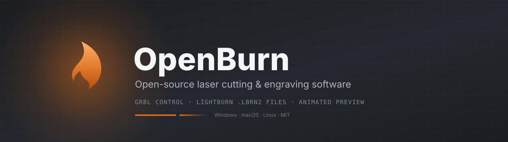
</p>

<h1 align="center">OpenBurn</h1>

<p align="center">
  Open-source <strong>laser cutting and engraving software</strong> for GRBL machines.<br/>
  Design, preview the toolpath and run the job — with native
  <code>.lbrn</code> / <code>.lbrn2</code> import and export.
</p>

<p align="center">
  <a href="https://openburn.pages.dev"></a>
  <a href="https://github.com/SJLS27/openburn/releases/latest"></a>
  <a href="https://github.com/SJLS27/openburn/actions/workflows/ci.yml"></a>
  <a href="LICENSE"></a>
  
  
  
  
</p>

<p align="center">
  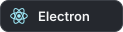
  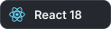
  
  
  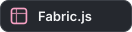
  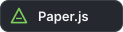
  
  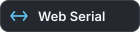
  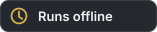
</p>

<p align="center">
  <strong>English</strong> ·
  <a href="README.es.md">Español</a> ·
  <a href="https://openburn.pages.dev">Website</a> ·
  <a href="#screenshots">Screenshots</a> ·
  <a href="#quick-start">Quick start</a> ·
  <a href="https://openburn.pages.dev/es/">Sitio en español</a>
</p>

<p align="center">
  <a href="https://github.com/SJLS27/openburn/releases/latest"><b>Download the latest release</b></a> ·
  <a href="docs/USAGE.md">User guide</a> ·
  <a href="https://openburn.pages.dev">openburn.pages.dev</a>
</p>

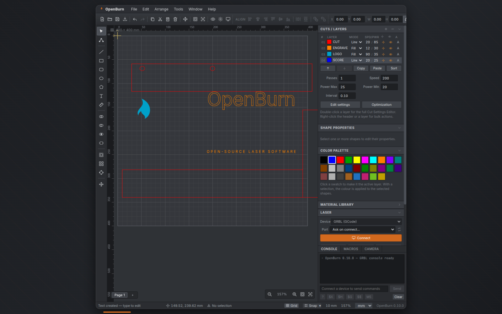

---

## Why OpenBurn?

- **A working LightBurn alternative, not a mockup.** Vectors, layers, booleans,
  text outlines, image engraving, cut planning, preview and GRBL streaming
  already work end to end.
- **Your `.lbrn2` files are welcome.** Open an existing LightBurn project, keep
  its layers and cut settings, edit it here and export it back.
- **Talk to the machine, not the cloud.** Native GRBL over Web Serial, plus a
  built-in simulator so you can rehearse a job without a laser.
- **Free, MIT and offline.** No account, no telemetry, no ads. The installer is
  a plain desktop app; your designs never leave your computer.

## What's new in 0.11

- **Full node editing** — drag Bézier handles, double-click a segment to add a
  node, delete selected nodes with `Del`, switch between corner / smooth /
  symmetric and between straight line and curve segments.
- **Object snapping** — vertices, centres, midpoints and intersections, with
  alignment guides while dragging and dedicated status bar options.
- **Versioned snap preferences** — persistent snapping settings with clean
  migration.
- **Headless desktop verification** — faster development iterations and
  automated documentation captures.

Full details in [CHANGELOG.md](CHANGELOG.md).

---

## Screenshots

<table>
  <tr>
    <td width="50%" align="center">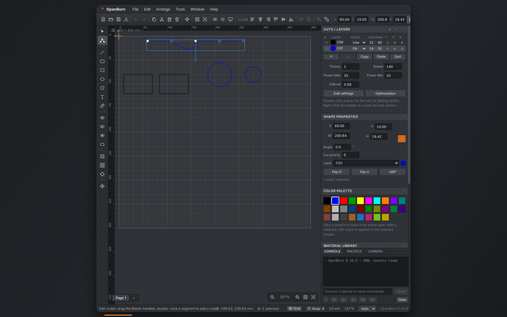<br/><sub><strong>Node editing</strong> — handles, node types and snapping</sub></td>
    <td width="50%" align="center">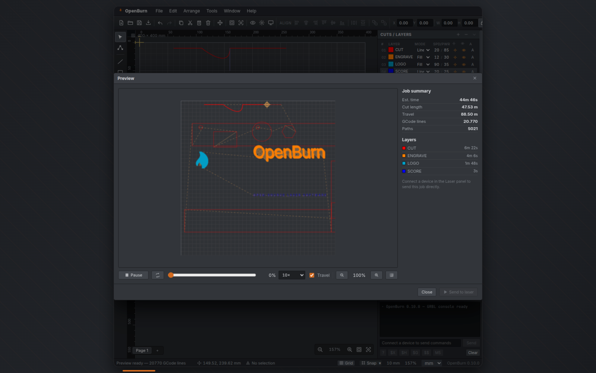<br/><sub><strong>Preview</strong> — toolpath, times and per-layer stats</sub></td>
  </tr>
  <tr>
    <td width="50%" align="center">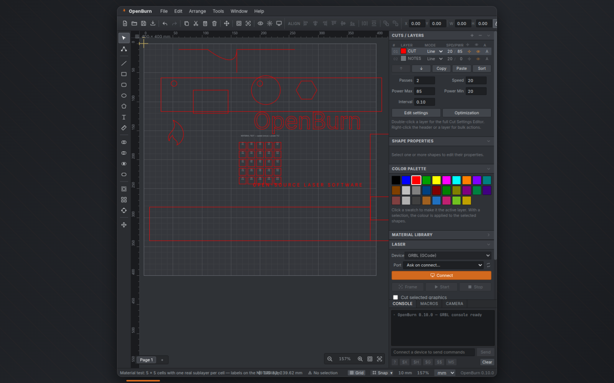<br/><sub><strong>Material test</strong> — power × speed with real sublayers</sub></td>
    <td width="50%" align="center">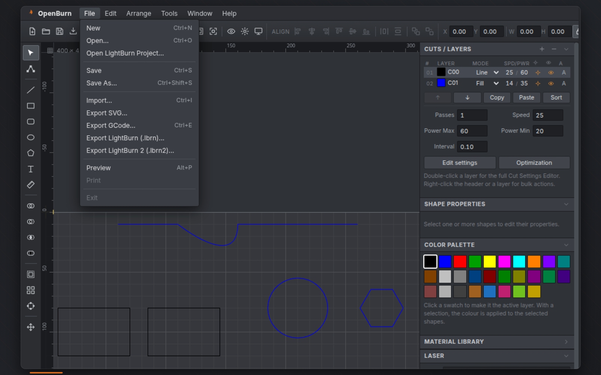<br/><sub><strong>LightBurn</strong> — open and export .lbrn / .lbrn2</sub></td>
  </tr>
  <tr>
    <td width="50%" align="center">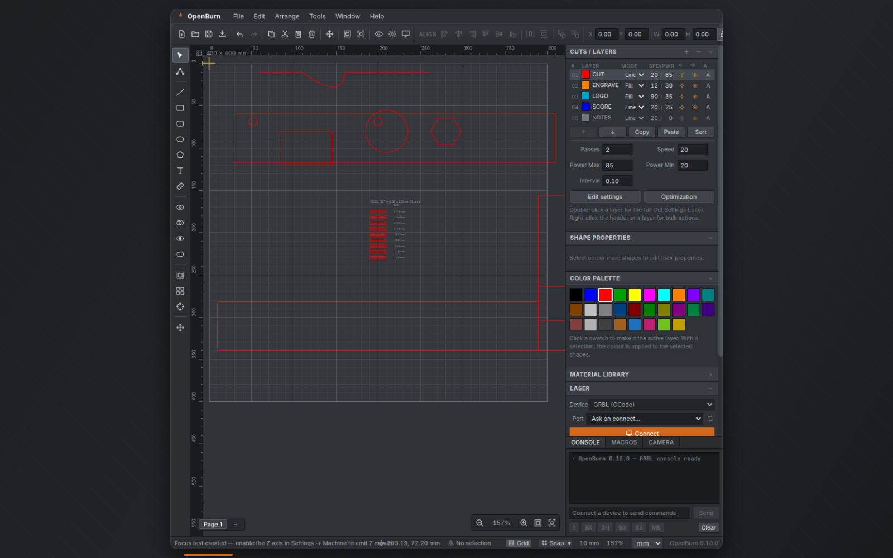<br/><sub><strong>Focus test</strong> — a Z ramp to find the perfect focus</sub></td>
    <td width="50%" align="center">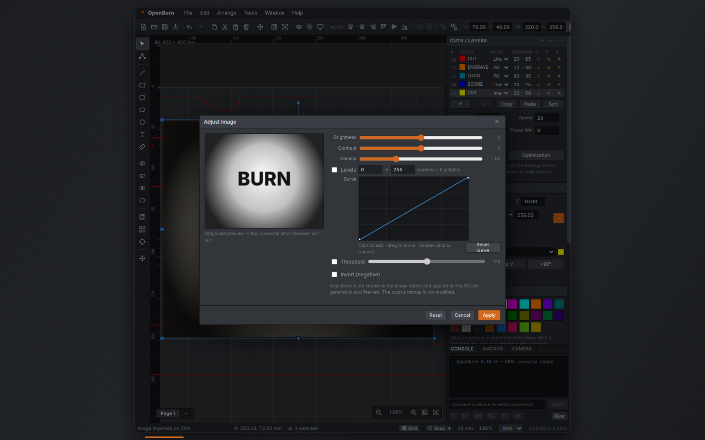<br/><sub><strong>Adjust image</strong> — levels, curves and live preview</sub></td>
  </tr>
</table>

---

## Features

### Vector design
- Line, rectangle, rounded rectangle, ellipse, polygon, text and measure tools.
- Select, move, scale, rotate, flip, align, distribute, group/ungroup and
  reorder.
- **Booleans** (union, subtract, intersect, exclude) powered by Paper.js.
- **Offset**, grid/circular arrays and full **node editing** (add/remove nodes,
  Bézier handles, line ↔ curve, corner / smooth / symmetric).
- **Snapping** to the grid, vertices, centres, midpoints and intersections,
  with alignment guides.
- **Text built from installed fonts**: the picker lists the families on your
  system and preview, GCode and export outline with the real typeface. If a
  font is missing, text falls back to the bundled Inter, you get a warning, and
  the original family is remembered for when you install it.
- **Add Tabs** to keep pieces attached, and **paste from the system
  clipboard** (text, SVG including Inkscape's compressed SVG, images).

### Layers and cut settings
- LightBurn-style palette (`C00`, `C01`, …): every colour is a layer.
- **Cuts / Layers panel** with mode, speed/power, output, show and air columns,
  layer reordering, context menus and quick fields for passes, speed, power and
  interval.
- **Cut Settings Editor** with Common/Advanced tabs: min power, dwell, overcut,
  lead-in/lead-out, Z offset and Z step per pass.
- **Line**, **Fill**, **Offset Fill** and **Image** modes with overscan,
  bidirectional, cross-hatch, flood fill and ramp.
- **Image engraving** modes: Threshold, Ordered, Atkinson, Dither, Stucki,
  Jarvis, Newsprint, Halftone, Sketch and Grayscale, plus Negative, dot width
  correction, angle increment and pass-through.
- **Kerf compensation** per layer, scan angle, cross-hatch and scan offset.
- Hairline preview strokes that stay 1 px at any zoom.
- Editable **material library** (name, thickness, speed, power, passes, mode
  and kerf) and per-object cut overrides.

### Preview and GCode
- GRBL GCode generated per layer, with origin mapping and `M3`/`M4`.
- **Animated preview** with scrub, speed control, laser head, estimated time
  and per-layer statistics.
- **Visible machine travel**, like LightBurn.
- **LightBurn-style cut planner** (Optimization Settings): order by layer, group
  or priority, cut inner shapes first, direction ordering, travel reduction,
  best start point, preferred corners, direction optimisation and removal of
  overlapping lines.
- Export to GCode (`.nc`) and LightBurn (`.lbrn` / `.lbrn2`).

### GRBL control
- Connect over **Web Serial** or the **built-in simulator** (no hardware
  needed). On the desktop app, Connect lists the real OS ports with their USB
  chip and never preselects the motherboard UART (`/dev/ttyS0`).
- Flow-controlled streaming, `Frame`, `Start`, `Pause/Resume` and `Stop`.
- **xTool firmware** (D1 and similar) is detected on connect (`$I` → `[XTool …]`)
  and can also be forced in **Settings → Machine**. On xTool the jog is sent as
  `G91` / `G1 … S0` / `G90` / `M2`, because that firmware ignores `$J`.
- Jog (`$J`), homing (`$H`), unlock (`$X`) and set origin (`G10 L20`).
- Two-way console and persistent macros.
- Live status: position, feed, spindle, progress and time remaining.

### Calibration
- **Material Test** (power × speed with real sublayers), **Interval Test**,
  **Focus Test** with a Z ramp and **Kerf Test**.
- **Material library** you can save and reuse in one click, including the
  measured kerf.
- Configurable **Z axis** with per-object offsets and `G1 Z` moves in the GCode.

### Images
- Import PNG, JPG, GIF, BMP and WebP.
- **Adjust Image**: brightness, contrast, gamma, levels, tone curve, threshold
  and invert, with a live grayscale preview.
- **Trace Image**: monochrome or colour vectorisation with threshold and detail
  control, a preview before applying and one layer per colour.
- **Apply Mask to Image** to crop a bitmap with a vector shape.

### Desktop workflow
- **Autosave** and recovery of unsaved work after an unexpected exit.
- **Welcome screen** with new, open and recent designs.
- **Recent files**, drag & drop of projects/SVG/DXF/images onto the exact spot
  they are dropped, persistent window size and bounded undo/redo.
- **Auto-update**: checks at startup, downloads in the background and offers
  *Restart & install*.

### LightBurn compatibility
- **Opens** `.lbrn` and `.lbrn2` projects: rectangles, ellipses, polygons,
  Bézier paths, groups, text with backup paths, bitmaps and cut settings.
- **Exports** both formats with geometry, text outlines, bitmaps and layers.

---

## Quick start

### Requirements
- Node.js **22.22+** and npm **10+** (only for development)
- Linux, macOS or Windows
- Optional: a GRBL machine connected over USB/serial

### Install

**AppImage (Linux x64)** — download it from the
[latest release](https://github.com/SJLS27/openburn/releases/latest):

```bash
chmod +x OpenBurn-*.AppImage
./OpenBurn-*.AppImage
```

**Windows** (NSIS installer) and **macOS** (DMG/ZIP) builds are published on the
same release page. **Flatpak**: the manifest and offline sources live in
[`flatpak/`](flatpak/README.md); Flathub submission is pending review.

**Build from source:**

```bash
git clone https://github.com/SJLS27/openburn.git
cd openburn
npm install
npm run dev            # browser with hot reload
npm run dev:electron   # desktop app (Electron + Vite)
npm run build:app      # installer: AppImage / NSIS / DMG
```

### First job
1. Choose **New Design** or **Open Project** on the welcome screen, or drag a
   `.obrn`, `.lbrn2`, SVG, DXF or image onto the canvas.
2. Pick a tool on the left bar and draw.
3. Assign a colour/layer in the palette and set speed and power in
   **Cuts / Layers**.
4. Press **Preview** (`Alt+P`) to check the toolpath and timings.
5. In the **Laser** panel connect your GRBL board or the **Simulator**, then
   press **Start**.
6. Save as `.obrn` (`Ctrl+S`) or export to LightBurn / GCode from **File**.

> **Native format:** `.obrn`. Legacy `.ovbrn` projects still open; they are
> converted to `.obrn` when saved.

### Keyboard shortcuts

| Action | Shortcut |
| --- | --- |
| New / Open / Save | `Ctrl+N` / `Ctrl+O` / `Ctrl+S` |
| Import artwork / Export GCode | `Ctrl+I` / `Ctrl+E` |
| Undo / Redo | `Ctrl+Z` / `Ctrl+Shift+Z` (`Ctrl+Y` too) |
| Copy / Cut / Paste / Duplicate | `Ctrl+C` / `Ctrl+X` / `Ctrl+V` / `Ctrl+D` |
| Paste in place | `Alt+V` |
| Select all / Delete | `Ctrl+A` / `Del` |
| Group / Ungroup | `Ctrl+G` / `Ctrl+U` |
| Flip horizontally / vertically | `H` / `V` |
| Rotate 90° clockwise / anticlockwise | `.` / `,` |
| Mirror across a line / rotate by two points | `Ctrl+Shift+M` / `Ctrl+2` |
| Tools | `S` select · `N` nodes · `L` line · `R` rect · `E` ellipse · `P` polygon · `T` text · `M` measure |
| Preview | `Alt+P` |
| Zoom to page / selection | `Ctrl+0` / `Ctrl+Shift+A` |
| Zoom in / out | `+` / `-` |
| Pan | `Space` + drag, or middle mouse |
| Paste from the system clipboard (internal clipboard filled) | `Ctrl+Shift+V` |

---

## LightBurn compatibility

OpenBurn reads and writes LightBurn's XML format without using its source code.

**Open:** *File → Open LightBurn Project…* or *File → Open…* with a
`.lbrn`/`.lbrn2` file. Layers, colours, geometry, groups, text backup paths,
images and cut settings are imported.

**Export:** *File → Export LightBurn (.lbrn)…* (legacy, readable XML) or
*File → Export LightBurn 2 (.lbrn2)…* (compact, current).

**Limits worth knowing**
- Layer colours in LightBurn come from the layer index; custom OpenBurn colours
  show as the palette colour there.
- Groups are flattened on export.
- Per-object overrides (material tests) export as layer settings.
- Rotated images export without rotation (with a warning).
- Text is exported as outlines using your installed font; imported text is
  editable and keeps its original family name.

Details in [docs/FILE-FORMATS.md](docs/FILE-FORMATS.md). If a project does not
open, please [open an issue](https://github.com/SJLS27/openburn/issues) with the
file (or an anonymised copy).

---

## Architecture

```
openburn/
├─ electron/           # main process, preload, auto-update (IPC, dialogs, assets)
├─ src/
│  ├─ core/            # .obrn document, units, DXF, file access
│  ├─ geometry/        # booleans, offset, tabs (Paper.js)
│  ├─ gcode/           # planning, optimisation and GCode generation
│  ├─ image/           # image adjustment and tracing
│  ├─ io/              # LightBurn import/export (.lbrn/.lbrn2)
│  ├─ serial/          # transports, GRBL controller and simulator
│  ├─ state/           # observable store + workspace API
│  ├─ text/            # text to outlines (opentype.js)
│  ├─ types/           # document model and types
│  ├─ ui/              # menus, toolbars, panels, dialogs, icons
│  └─ workspace/       # Fabric.js controller (tools, history)
├─ e2e/                # end-to-end tests (Playwright + Electron)
├─ public/fonts/       # Inter (OFL) for outlines
└─ docs/               # documentation, screenshots and brand assets
```

The document lives in an **observable store**, the canvas is **Fabric.js**, the
toolpath geometry is **Paper.js**, and jobs are sent by a **GRBL controller**
with interchangeable transports (Web Serial or simulator).

More in [docs/ARCHITECTURE.md](docs/ARCHITECTURE.md).

---

## Documentation

| Document | Contents |
| --- | --- |
| [docs/USAGE.md](docs/USAGE.md) | User guide: design, layers, preview, GRBL, tests, images and tabs |
| [docs/FILE-FORMATS.md](docs/FILE-FORMATS.md) | `.obrn` and the detailed `.lbrn`/`.lbrn2` mapping |
| [docs/ARCHITECTURE.md](docs/ARCHITECTURE.md) | Modules, data flow and the GCode pipeline |
| [docs/DEVELOPMENT.md](docs/DEVELOPMENT.md) | Environment, scripts, tests and packaging |
| [website/README.md](website/README.md) | Public site: bilingual content, Cloudflare Pages and Search Console |
| [CHANGELOG.md](CHANGELOG.md) | Changes per release |
| [AGENTS.md](AGENTS.md) | Testing policy, conventions and checklist for agents/contributors |
| [TODO.md](TODO.md) | Task list and roadmap |

### Contributing
Issues and pull requests are welcome — see [CONTRIBUTING.md](CONTRIBUTING.md).
Every change must keep `npm run typecheck`, `npm run test` and `npm run build`
green; new features come with tests ([AGENTS.md](AGENTS.md)).

---

## Roadmap

- [x] **Auto-update** — startup check, background download, restart prompt and
  automatic publishing to GitHub Releases
- [x] **Testing** — Vitest + Testing Library, Playwright/Electron, CI and the
  policy in [AGENTS.md](AGENTS.md)
- [x] Vector design core and layers
- [x] Preview, GCode and GRBL control
- [x] Text outlines, Material/Interval/Focus tests, images, tabs and planner
- [x] Kerf, cross-hatch, scan offset, material library, Z axis and kerf test
- [x] LightBurn compatibility (`.lbrn`/`.lbrn2` read and write)
- [x] **Desktop fundamentals** — autosave and recovery, recents, welcome screen,
  drag & drop, persistent window, bounded history
- [x] **Node editing and snapping**
- [ ] **Multiple documents** — tabs/windows with a multi-document store
- [ ] Rotary, cameras and Print & Cut
- [ ] Ruida/DSP and galvo (EZCad) controllers
- [ ] Signed packages (Windows/macOS certificates)
- [ ] **Tauri migration (exploration)** — evaluate an alternative desktop shell
  (Rust + webview) to shrink the installer and memory footprint; an open idea,
  not planned for a specific release

Status and details in [TODO.md](TODO.md).

---

## License and credits

- Code: **MIT** — see [LICENSE](LICENSE).
- **Support the project:** [PayPal](https://paypal.me/openburn) ·
  [support page](https://openburn.pages.dev/support/) (no ads, no cookies).
- **Inter** font: SIL Open Font License 1.1 —
  [public/fonts/Inter-LICENSE.txt](public/fonts/Inter-LICENSE.txt).
- [Fabric.js](https://github.com/fabricjs/fabric.js) (MIT),
  [Paper.js](https://github.com/paperjs/paper.js) (MIT),
  [opentype.js](https://github.com/opentypejs/opentype.js) (MIT),
  [ImageTracer](https://github.com/jankovicsandras/imagetracerjs) (Unlicense).

> **Disclaimer:** OpenBurn is not affiliated with LightBurn Software Inc. The
> interface was rebuilt from public documentation and the icons are original.
> File compatibility was implemented from the XML format and public samples,
> without using LightBurn's source code.

<p align="center"><sub>Made with ☕ and many laser passes.</sub></p>
