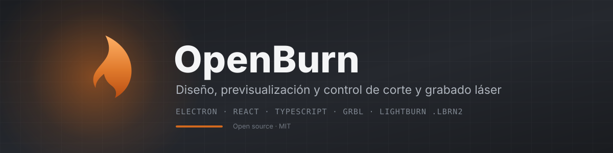
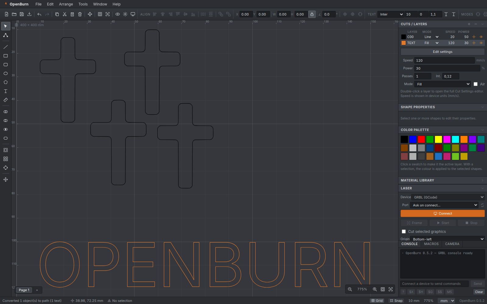
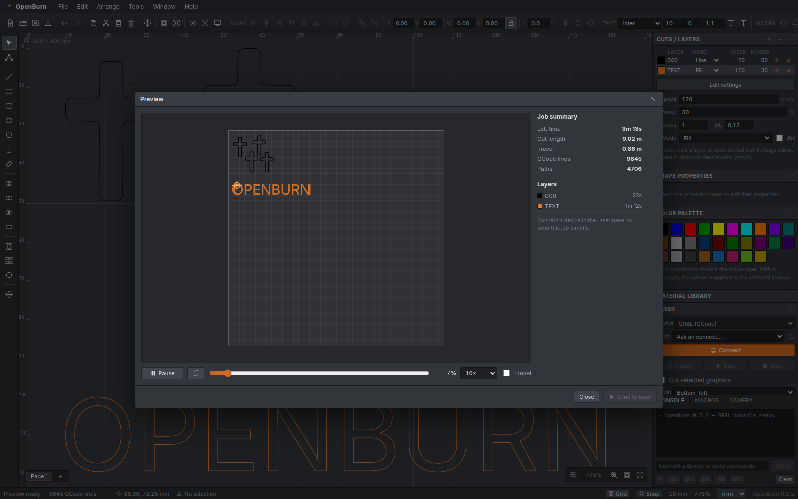
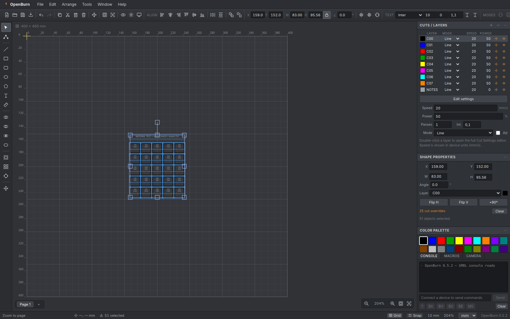
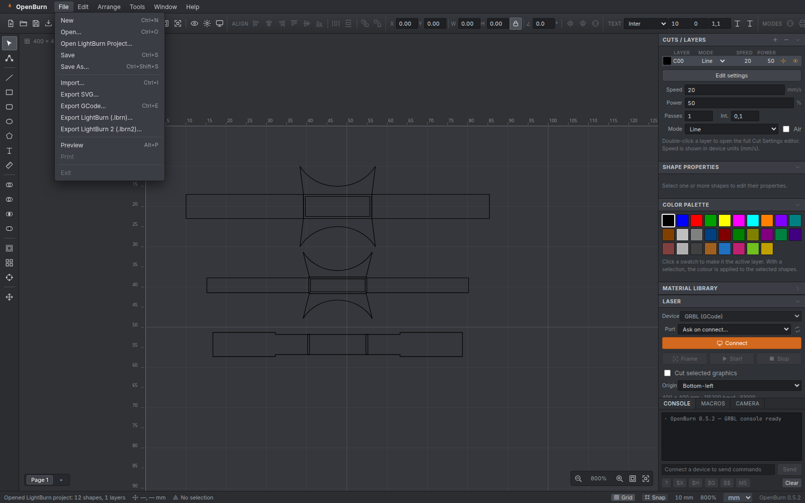
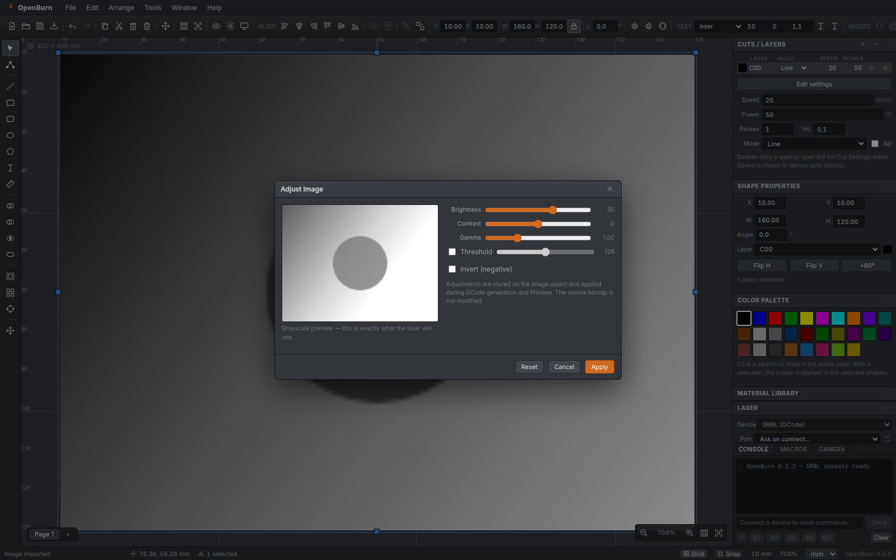

<p align="center">
  
</p>

<p align="center">
  <a href="LICENSE"></a>
  <a href="https://github.com/SJLS27/openburn/actions/workflows/ci.yml"></a>
  
  
  
  
  
  
</p>

<p align="center">
  Software open-source de <strong>diseño, previsualización y control de máquinas láser</strong>.<br/>
  Alternativa libre inspirada en el flujo de trabajo de LightBurn, con importación y exportación de sus proyectos <code>.lbrn</code> y <code>.lbrn2</code>.
</p>

<p align="center">
  <a href="#-características">Características</a> ·
  <a href="#-capturas">Capturas</a> ·
  <a href="#-inicio-rápido">Inicio rápido</a> ·
  <a href="#-compatibilidad-con-lightburn">LightBurn</a> ·
  <a href="#-documentación">Documentación</a> ·
  <a href="#-roadmap">Roadmap</a>
</p>



---

## ✨ Características

### Diseño vectorial
- Línea, rectángulo, rectángulo redondeado, elipse, polígono, texto y medida.
- Selección múltiple, mover, escalar, rotar, voltear, alinear, distribuir, agrupar/desagrupar y orden.
- **Booleanos** (unión, resta, intersección, exclusión) con Paper.js.
- **Offset** de contornos, arrays en cuadrícula/circulares y **edición de nodos**.
- **Texto a contornos** con opentype.js (fuente Inter incluida) para cortar o grabar sin depender de fuentes.
- **Add Tabs**: puentes en contornos para que las piezas no se suelten.
- **Pegado desde el portapapeles del sistema**: texto, SVG e imágenes, además de menú contextual en el lienzo.

### Capas y operaciones
- Paleta de colores tipo LightBurn (`C00`, `C01`, …), cada color es una capa.
- Modos **Line**, **Fill**, **Offset Fill** e **Image** con velocidad, potencia, pasadas, intervalo, overscan y dithering.
- Overrides de corte por objeto (usados por los tests de material).
- Capa de anotaciones `NOTES` que nunca se envía al láser.

### Preview y GCode
- Generación de GCode GRBL por capas, con mapeo de origen y `M3`/`M4`.
- **Preview animado** con scrub, velocidad, cabeza láser, tiempo estimado y estadísticas por capa.
- Optimización de recorridos (vecino más cercano) para reducir viajes.
- Exportación de GCode (`.nc`) y LightBurn (`.lbrn` / `.lbrn2`).

### Control GRBL
- Conexión por **Web Serial** o **simulador integrado** (sin hardware).
- Streaming con control de flujo, `Frame`, `Start`, `Pause/Resume`, `Stop`.
- Jog (`$J`), homing (`$H`), unlock (`$X`), set origin (`G10 L20`).
- Consola bidireccional y macros persistentes.
- Estado en vivo: posición, feed, spindle, progreso y tiempo restante.

### Imágenes
- Importación de PNG/JPG/GIF/BMP/WebP.
- **Adjust Image**: brillo, contraste, gamma, umbral e invertir, con previsualización en vivo.
- **Trace Image**: vectorización monochrome o color con control de umbral y detalle.

### Compatibilidad LightBurn
- **Abre** proyectos `.lbrn` y `.lbrn2` (rectángulos, elipses, polígonos, paths con Bézier, grupos, texto con *backup path*, bitmaps y cut settings).
- **Exporta** `.lbrn` (legado, legible) y `.lbrn2` (compacto) con geometría, texto en contornos, bitmaps y capas.
- Ver [Compatibilidad con LightBurn](#-compatibilidad-con-lightburn).

---

## 📸 Capturas

<table>
  <tr>
    <td width="50%" align="center"><br/><sub><strong>Preview</strong> — trayectorias, tiempos y cabeza láser</sub></td>
    <td width="50%" align="center"><br/><sub><strong>Material Test</strong> — matriz potencia × velocidad</sub></td>
  </tr>
  <tr>
    <td width="50%" align="center"><br/><sub><strong>LightBurn</strong> — abrir y exportar .lbrn/.lbrn2</sub></td>
    <td width="50%" align="center"><br/><sub><strong>Adjust Image</strong> — previsualización en escala de grises</sub></td>
  </tr>
</table>

---

## 🚀 Inicio rápido

### Requisitos
- Node.js **20+** y npm **10+**
- Linux, macOS o Windows
- Opcional: máquina GRBL conectada por USB/serie

```bash
git clone https://github.com/SJLS27/openburn.git
cd openburn
npm install
```

### Desarrollo

```bash
npm run dev            # navegador con recarga en caliente
npm run dev:electron   # app de escritorio (Electron + Vite)
```

### Producción

```bash
npm run build          # TypeScript + Vite + proceso principal
npm run build:app      # instalador (AppImage / NSIS / DMG) con electron-builder
```

### Primeros pasos
1. Elige una herramienta en la barra izquierda y dibuja en el lienzo.
2. Asigna color/capa desde la paleta y ajusta velocidad/potencia en **Cuts / Layers**.
3. Pulsa **Preview** (`Alt+P`) para revisar trayectorias y tiempos.
4. En el panel **Laser**, conecta tu GRBL o el **Simulator (demo)** y pulsa **Start**.
5. Guarda como `.obrn` (`Ctrl+S`) o exporta a LightBurn / GCode desde **File**.

> **Formato nativo:** `.obrn`. Los proyectos antiguos `.ovbrn` se pueden abrir; al guardar se
> convierten a `.obrn`.

---

## ⌨️ Atajos principales

| Acción | Atajo |
| --- | --- |
| Nuevo / Abrir / Guardar | `Ctrl+N` / `Ctrl+O` / `Ctrl+S` |
| Importar artwork / Exportar GCode | `Ctrl+I` / `Ctrl+E` |
| Deshacer / Rehacer | `Ctrl+Z` / `Ctrl+Y` |
| Copiar / Cortar / Pegar / Duplicar | `Ctrl+C` / `Ctrl+X` / `Ctrl+V` / `Ctrl+D` |
| Seleccionar todo / Eliminar | `Ctrl+A` / `Supr` |
| Agrupar / Desagrupar | `Ctrl+G` / `Ctrl+Shift+G` |
| Herramientas | `V` seleccionar · `N` nodos · `L` línea · `R` rectángulo · `E` elipse · `P` polígono · `T` texto · `M` medir |
| Preview | `Alt+P` |
| Zoom a página / a selección | `Ctrl+0` / `Ctrl+=` |
| Paneo | `Espacio` + arrastrar, o botón central |
| Pegar desde el sistema (con portapapeles interno lleno) | `Ctrl+Shift+V` |

---

## 🔄 Compatibilidad con LightBurn

OpenBurn lee y escribe el formato XML de LightBurn sin usar su código original.

### Abrir
- **File → Open LightBurn Project…** o simplemente **File → Open…** con un `.lbrn`/`.lbrn2`.
- Se importan capas (CutSetting), colores por índice, geometría, grupos, texto con contornos de respaldo, imágenes y ajustes de corte.

### Exportar
- **File → Export LightBurn (.lbrn)…** — formato legado, XML legible.
- **File → Export LightBurn 2 (.lbrn2)…** — formato compacto actual.

### Detalles y límites
- Los colores de capa en LightBurn se derivan del **índice** de la capa; los colores personalizados de OpenBurn pueden mostrarse con el color de la paleta en LightBurn.
- Los grupos se aplanan al exportar.
- Los overrides por objeto (Material Test) se exportan como ajustes de capa.
- Las imágenes rotadas se exportan sin rotación (con aviso).
- Texto: al exportar se convierten a contornos (no dependen de fuentes); al importar se usan los contornos de respaldo si existen.
- El formato no está documentado oficialmente; la implementación se validó contra archivos reales y round-trip. Si encuentras un proyecto que no abre, abre un issue con el archivo (o una versión anonimizada).

Más detalles en [docs/FILE-FORMATS.md](docs/FILE-FORMATS.md).

---

## 🧱 Arquitectura

```
openburn/
├─ electron/           # proceso principal y preload (IPC, diálogos, assets)
├─ src/
│  ├─ core/            # .obrn, unidades, DXF, acceso a archivos
│  ├─ geometry/        # booleanos, offset, tabs (Paper.js)
│  ├─ gcode/           # planificación, optimización y generación de GCode
│  ├─ image/           # ajuste de imagen y vectorización
│  ├─ io/              # import/export LightBurn (.lbrn/.lbrn2)
│  ├─ serial/          # transportes, controlador GRBL y simulador
│  ├─ state/           # store observable + API del workspace
│  ├─ text/            # texto a contornos (opentype.js)
│  ├─ types/           # modelo de documento y tipos
│  ├─ ui/              # menús, toolbars, paneles, diálogos, iconos
│  └─ workspace/       # controlador Fabric.js (herramientas, historial)
├─ public/fonts/       # Inter (OFL) para contornos
├─ docs/               # documentación y capturas
└─ tests manuales/     # scripts de validación (no incluidos)
```

Puntos clave: el documento vive en un **store observable**, el lienzo en **Fabric.js**, la geometría de mecanizado en **Paper.js**, y el envío a la máquina en un **controlador GRBL** con transporte intercambiable (Web Serial o simulador).

Más en [docs/ARCHITECTURE.md](docs/ARCHITECTURE.md).

---

## 📚 Documentación

| Documento | Contenido |
| --- | --- |
| [docs/USAGE.md](docs/USAGE.md) | Guía de uso: diseño, capas, preview, GRBL, tests, imágenes y tabs |
| [docs/FILE-FORMATS.md](docs/FILE-FORMATS.md) | `.obrn` y mapeo detallado `.lbrn`/`.lbrn2` |
| [docs/ARCHITECTURE.md](docs/ARCHITECTURE.md) | Módulos, flujo de datos y pipeline de GCode |
| [docs/DEVELOPMENT.md](docs/DEVELOPMENT.md) | Entorno, scripts, pruebas y empaquetado |
| [TODO.md](TODO.md) | Lista de tareas y roadmap |

---

## 🗺️ Roadmap

- [x] Fase 1 — Núcleo de diseño vectorial y capas
- [x] Fase 2 — Preview, GCode y control GRBL
- [x] Fase 3 — Texto a contornos, Material/Interval Test, imágenes (ajuste/trace), tabs y optimización
- [x] Compatibilidad LightBurn (lectura y escritura `.lbrn`/`.lbrn2`)
- [ ] Focus Test (requiere eje Z)
- [ ] Rotary, cámaras y Print & Cut
- [ ] Ruida/DSP y galvo (EZCad)
- [ ] Empaquetado firmado y auto-update

Detalle y estado en [TODO.md](TODO.md).

---

## 🧩 Stack

**Electron** · **React 18** · **TypeScript** · **Vite** · **Fabric.js 6** · **Paper.js** · **opentype.js** · **ImageTracer** · **Web Serial**

---

## 📄 Licencia y créditos

- Código: **MIT** — ver [LICENSE](LICENSE).
- Fuente **Inter**: SIL Open Font License 1.1 — [public/fonts/Inter-LICENSE.txt](public/fonts/Inter-LICENSE.txt).
- [Fabric.js](https://github.com/fabricjs/fabric.js) (MIT), [Paper.js](https://github.com/paperjs/paper.js) (MIT), [opentype.js](https://github.com/opentypejs/opentype.js) (MIT), [ImageTracer](https://github.com/jankovicsandras/imagetracerjs) (Unlicense).

> **Aviso:** OpenBurn no está afiliado a LightBurn Software Inc. La interfaz se reconstruyó a partir de documentación pública y los iconos son propios. La compatibilidad de archivos se implementó a partir del formato XML y ejemplos públicos, sin utilizar el código fuente de LightBurn.

<p align="center"><sub>Hecho con ☕ y muchas pasadas de láser.</sub></p>
