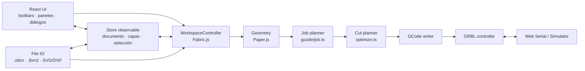

# Arquitectura

OpenBurn es una app **Electron + React + TypeScript** con tres motores principales:

1. **Fabric.js** para el modelo y la edición del lienzo.
2. **Paper.js** para geometría booleana, offset y vectorización de trayectorias.
3. **Controlador GRBL** con transporte Web Serial o simulador.



---

## 1. Capas de la aplicación

| Carpeta | Responsabilidad |
| --- | --- |
| `electron/` | Ventana (tamaño/posición persistidos), IPC (diálogos, fs, assets, autoguardado, recientes), permisos Web Serial y auto-update |
| `src/core/` | `.obrn`, unidades, DXF, acceso a archivos |
| `src/state/` | Store observable, interfaz `WorkspaceApi`, autoguardado, archivos recientes y confirmación de descartes |
| `src/workspace/` | `WorkspaceController`: herramientas, selección, zoom, nodos y `HistoryBuffer` con presupuesto de memoria. Lógica pura: `nodes.ts` (modelo de nodos), `snap.ts` (motor de snapping), `ruler.ts`, `measure.ts`, `transform.ts`, `numeric.ts` |
| `src/ui/` | Menús, toolbars, paneles, diálogos, iconos |
| `src/geometry/` | Booleanos/offset (Paper.js), tabs |
| `src/gcode/` | Geometría de mecanizado, planificación, optimización y GCode |
| `src/image/` | Ajuste de imagen y vectorización (ImageTracer) |
| `src/text/` | Texto a contornos (opentype.js) |
| `src/serial/` | Transportes y controlador GRBL |
| `src/io/` | Import/export LightBurn |

---

## 2. Estado y controller

- El documento (`OpenBurnDocument`) contiene capas, cama, unidades y la escena serializada.
- `store` es un store observable minimalista (`useSyncExternalStore`) con el estado de UI: herramienta activa, selección, zoom, cursor, dispositivo, etc.
- `WorkspaceController` se registra en `WorkspaceApi` para que la UI invoque comandos imperativos (nuevo, guardar, alinear, booleanos…).
- Cada cambio relevante de la escena se snapshotea para **undo/redo**. Los snapshots excluyen los nodos temporales (`excludeFromExport`).
- `src/workspace/history.ts` (`HistoryBuffer`) limita el historial por número de entradas **y por bytes** (64 MB por defecto). Las imágenes viajan como data URLs, así que un puñado de snapshots puede pesar cientos de MB; al exceder el presupuesto se descartan los más antiguos.

Las propiedades por objeto viajan con la escena:

```ts
FabricObject.customProperties = ['layerId', 'cutOverride', 'imageAdjust'];
```

---

## 3. Render y coordenadas

- El lienzo de Fabric se dibuja sobre un `<canvas>` de fondo que pinta cama, grid, reglas y origen.
- Ambas capas comparten `viewportTransform`.
- El espacio de trabajo usa **mm** y **Y hacia abajo** (origen arriba-izquierda).
- Al importar LightBurn se aplica `y' = -y` y se normaliza el conjunto.
- Al exportar se invierte con `y_lb = bed.height - y_scene`.

---

## 3b. Edición de nodos y snapping

- **`src/workspace/nodes.ts`** es el modelo canónico de un trazado. Un nodo es
  `{ anchor, handleIn: Pt | null, handleOut: Pt | null, type }`, sin campos
  opcionales, y la representación interna usa solo `M/L/C/Z`. Cuadráticas,
  arcos y atajos (`Q`, `T`, `A`, `H`, `V`) se normalizan a cúbicas al editar.
  Un path que no se edita conserva sus comandos originales.
- Al cerrar un path la curva de cierre se guarda en `closingCurve`, porque
  `Z` solo dibuja una línea recta. `buildPath` la emite como cúbica antes de
  `Z` y omite la línea de cierre redundante.
- Operaciones puras probadas en `nodes.test.ts`: `insertNode` (división de
  De Casteljau, sin deformar la curva), `removeNode`, `removeNodes` (varios a la
  vez, índices independientes), `makeLine`/`makeCurve`, `setNodeType`,
  `moveAnchor`/`moveHandle` y `nearestOnSubpath`.
- **`src/workspace/snap.ts`** es el motor de snapping. `SnapTarget` tiene
  `kind: 'grid' | 'vertex' | 'center' | 'midpoint' | 'intersection' | 'guide'`;
  `guide` está reservado para las guías inteligentes del próximo update, igual
  que el resto de objetos que consumirán `targetsForShape`. El radio se mide en
  **píxeles de pantalla** (`snapRadiusScene`) y el controlador pasa
  `zoom = 1 / canvas.getZoom()`.
- El snapping se aplica al crear formas (`snapDrawPoint`), al mover una
  selección (`applyDragSnap`, con guías rojas) y al arrastrar un nodo
  (`moveAnchorHandle`). Los objetos se identifican con `objectId` para que nada
  se enganche a sí mismo.
- Las preferencias viven en `snapSettings` (`src/state/snapSettings.ts`),
  versionadas y persistidas en `openburn.snap`; el antiguo booleano
  `snapToGrid` se mantiene sincronizado como `enabled && grid`.

---

## 4. Pipeline de GCode

```
Formas Fabric
   │  (objectContours: toSVG → Paper.js → flatten)
   ▼
Contornos en coordenadas de escena
   │
   ├─ Line: contornos, con kerf opcional (expande/contrae cerrados)
   ├─ Fill: scanlines a `angle` (y +90° con cross-hatch) + scan offset
   ├─ Offset Fill: offsets concéntricos (polígonos)
   └─ Image: filas con potencia por punto
   ▼
PlanSegment[]  { rapid | cut, points, feed, power, powers, z }
   │  (optimizeSegments: vecino más cercano por capa)
   ▼
emitGcode: cabecera, M3/M4, G1 Z (si hay eje Z), G0/G1, M5, M2
   │  (mapeo de origen)
   ▼
GCode + estadísticas (tiempo, distancia, bounds)
```

- **Preview** consume el mismo `JobPlan`, por lo que trayectorias y tiempos coinciden con el envío.
  Se dibuja con un único `<svg viewBox>` en milímetros: el zoom/pan cambian el
  `viewBox` (los trazos se reescalan geómetras, nunca se pixelan) y el grabado
  de imágenes se reconstruye como una **textura raster** (`src/gcode/rasterTexture.ts`)
  que muestra la imagen tal como la quema el láser, no como líneas de 1 px.
  El motor rebobina los `powers[]` de cada scanline con la misma regla que el
  G-code (`powerForMove`) y lo ancla a la cama vía `<image>`; el playhead revela
  la textura fila a fila. Los trazos vectoriales se pintan como `<path>` por
  encima.
- Los segmentos raster llevan `powers[]` y emiten `G1 X Y S…` para variar potencia punto a punto.
- El kerf se aplica al contorno antes de cerrarlo; los offsets que colapsan se descartan.
- Con `zAxisEnabled`, cada cambio de `zOffset` emite un `G1 Z…` con el feed configurado y el job vuelve a `Z0` al terminar.
- Los Material Tests con *sublayers* crean una capa por celda; el job las procesa como capas normales y la exportación LightBurn genera un `CutSetting` por celda.
- El control de flujo del envío usa una ventana de 120 bytes y acks de GRBL.

---

## 5. Comunicación con la máquina

```
UI (Laser/Move/Console)
   → machine (singleton)
     → GrblController lógico
       → Transport
         ├─ WebSerialTransport (navigator.serial)
         └─ MockTransport (simulador con tiempos)
```

- `machine` mantiene estado observable: conexión, `MPos`, feed, spindle, trabajo, progreso y logs.
- Polling de estado cada 250 ms (`?`); en xTool es `?\n` y se pausa durante
  trabajos porque cada respuesta añade un `ok` que descontaría líneas.
- Pausa/resume con `!`/`~`; stop con feed hold + soft reset (`Ctrl+X`). En xTool
  el firmware solo mueve al recibir `M2`, así que ningún trabajo nuevo debe
  asumir que el progreso coincide con el cabezal (ver `TODO.md`).
- En Electron, el proceso principal concede permisos Web Serial y reenvía la lista de
  puertos (`select-serial-port`) al renderer por IPC (`serial:choose-port`); el
  diálogo `SerialPortDialog` responde con `serial:port-chosen`. La lógica de
  recomendación (USB primero, nunca `ttyS*`) está en `electron/serialPort.ts`.

---

## 6. Auto-update

```
electron/updater.ts          autoUpdater (electron-updater)
   │  checking · update-available · download-progress · update-downloaded · error
   ▼  IPC 'updater:event'
electron/preload.ts          window.openburn.updater { check, download, install, onEvent }
   ▼
src/state/updateStore.ts     store observable (useSyncExternalStore)
   ▼
src/ui/UpdateDialog.tsx      banner de progreso + diálogo "Restart & install"
```

- Solo se activa con `app.isPackaged`. En Linux exige la build **AppImage** (`APPIMAGE` definido); Flatpak y los paquetes de distro se actualizan desde su propia tienda.
- `autoDownload = true` y `autoInstallOnAppQuit = true`: la descarga arranca al detectar la versión y el usuario decide cuándo reiniciar. `quitAndInstall(false, true)` reabre la app tras instalar.
- El feed se define en `build.publish` (GitHub Releases). `.github/workflows/release.yml` compila y publica al empujar un tag `v*`, incluidos `latest.yml` / `latest-*.yml`.
- La comprobación de arranque se retrasa 5 s para no competir con el primer render; **Help → Check for Updates…** (menú nativo y menú in-app) lanza una comprobación manual y abre el diálogo.
- El main cachea el último estado: si el renderer se suscribe tarde, `updater:get-state` hidrata el store.
- En macOS, Squirrel exige un bundle firmado. `updater.ts` detecta la firma una vez con `codesign` al arrancar y, si no existe, reporta `disabled` con una explicación en lugar de fallar al comprobar.
- `release.yml` reutiliza el workflow de CI (`workflow_call`) y el job de publicación depende de él: un tag no publica nada si typecheck, tests, build o e2e están en rojo.
- La firma de código (Windows/macOS) sigue pendiente; sin ella macOS no puede aplicar actualizaciones en producción.

---

## 7. Texto e imágenes

- **Texto a contornos**: opentype.js resuelve la familia del objeto contra el índice de fuentes del sistema (`electron/fonts.ts` → `fonts:list`, `fs`/`fc-list`), la carga por IPC con allow-list (`fonts:read`) y reconstruye líneas/alineación/rotación con la matriz de Fabric. Si la familia no está instalada, usa la Inter incluida (`public/fonts/`) y marca `font.substituted` para que el llamador avise.
- **Coste de construir el job**: `src/gcode/job.bench.test.ts` (opt-in con `BENCH=1`) mide lo que cuesta el Preview/GCode. Con 200 rellenos son ~1,3 s, de los que **~1,1 s son Paper.js** (`getIntersections` de cada scanline y el `importSVG` de cada objeto) y solo **~0,18 s** el planificador. Por eso no hay Web Worker: atacar el 86 % de Paper (relleno analítico de formas simples y caché de contornos) vale más que mover el planificador a otro hilo.
- **Arranque sin fuentes**: Chromium lee `fontconfig` antes de ejecutar cualquier JS de la app, así que el fallback no puede aplicarse en el mismo proceso. `electron/fontFallback.ts` detecta que no hay ninguna fuente (`fc-list` y los `<dir>` del `fonts.conf`), escribe un `fontconfig` que añade la Inter incluida con su propio `cachedir` y el proceso principal **se relanza una vez** con `FONTCONFIG_FILE` apuntando a él (marcador `OPENBURN_FONT_FALLBACK` para no entrar en bucle). Si el segundo arranque tampoco ve fuentes, sale el diálogo *No fonts found*.
- **Adjust Image**: `applyImageAdjust` se comparte entre el rasterizador y la previsualización para que el resultado sea idéntico.
- **Trace Image**: se dibuja la imagen a ≤700 px, se cuantiza (mono/color) y se pasa a ImageTracer; el SVG resultante se importa con Fabric y se ajusta al rectángulo original.

---

## 8. Import/export LightBurn

`src/io/lightburn.ts` implementa:

- **Parser XML** con `DOMParser`.
- Soporte de `Rect`, `Ellipse`, `Polygon`, `Path`, `Group`, `Text` (`BackupPath`), `Bitmap` y `CutSetting`.
- Lectura de `VertList` compacto y `<V>/<P>` legado, incluidos handles Bézier y plantillas `VertID/PrimID`.
- **Serializer** que escribe XML legado o compacto, con contornos en coordenadas absolutas, texto en contornos y bitmaps base64.

No usa el código de LightBurn; se basa en el formato XML y en archivos de ejemplo reales.

---

## 9. Fundamentos de escritorio (autoguardado, recientes, ventana)

```
src/App.tsx ── AutosaveScheduler (debounce 2 s / flush 30 s) ──► IPC 'autosave:write'
   │                                                              │
   │  store.dirty = false ───────────────────────────────────────► 'autosave:clear'
   │                                                              ▼
   │                                                   userData/autosave.json
   └─ al arrancar: 'autosave:read' → RecoveryDialog (Recover / Discard)
```

- **Autoguardado**: solo se escribe mientras el documento está sucio. Si la app
  termina de forma limpia (o se guarda), el borrador se elimina; si se cae, el
  siguiente arranque ofrece recuperarlo y lo restaura como cambios sin guardar.
- **Recientes**: `electron/recentFiles.ts` mantiene hasta 10 rutas en
  `userData/recent-files.json` (deduplicadas, filtrando archivos que ya no
  existen). Alimenta `File → Open Recent` y la pantalla de bienvenida.
- **Ventana**: `electron/windowState.ts` valida los bounds guardados contra los
  monitores actuales (mínimo visible, monitor desaparecido, tamaño máximo) y los
  persiste con debounce en `resize`/`move` y al cerrar.
- **Drag & drop**: `src/core/dropRouting.ts` decide qué hacer con cada extensión;
  el renderer obtiene la ruta real con `webUtils.getPathForFile` (Electron 32+
  eliminó `File.path`) y cae a `File.text()`/`arrayBuffer()` en navegador.
  `will-navigate` está bloqueado para que un drop no saque la app del editor.
- **Descartes**: `src/state/discardGuard.ts` centraliza la confirmación
  Guardar / Descartar / Cancelar que usan New, Open, Open Recent y el drop de
  proyectos.
- **Perfiles aislados**: `OPENBURN_USER_DATA_DIR` redirige todo el estado del
  main (ventana, borradores, recientes); los e2e lo apuntan a un directorio
  temporal para no tocar la configuración real.

---

## 10. Pruebas

La política completa está en [AGENTS.md](../AGENTS.md).

- **Unitarios/componentes**: Vitest + jsdom + Testing Library
  (`vitest.config.ts`, setup en `src/test/setup.ts`).
  - Lógica pura: `src/core/units.test.ts`, `src/core/serialize.test.ts`,
    `src/gcode/types.test.ts`, `src/gcode/optimize.test.ts`.
  - Estado: `src/state/updateStore.test.ts`, `src/state/autosave.test.ts`,
    `src/state/recentStore.test.ts`.
  - Rendimiento/memoria: `src/workspace/history.test.ts`.
  - Edición de nodos y snapping: `src/workspace/nodes.test.ts`,
    `src/workspace/snap.test.ts`, `src/state/snapSettings.test.ts`,
    `src/ui/StatusBar.test.tsx`.
  - Componentes: `src/ui/UpdateDialog.test.tsx`,
    `src/ui/WelcomeDialog.test.tsx`, `src/ui/DiscardChangesDialog.test.tsx`,
    `src/ui/RecoveryDialog.test.tsx`.
  - Proceso principal: `electron/updater.test.ts`, `electron/windowState.test.ts`,
    `electron/autosave.test.ts`, `electron/recentFiles.test.ts`,
    `electron/storage.test.ts` (mockean `electron` y usan un `userData` temporal).
- **End-to-end**: Playwright `_electron` sobre `dist/` + `dist-electron/`
  (`playwright.config.ts`, specs en `e2e/`). Cubre arranque de la ventana y
  pantalla de bienvenida, versión del proceso principal, actualizaciones,
  portapapeles, paneo, recuperación tras un cierre abrupto, drag & drop,
  recientes, edición de nodos y snapping, y restauración del tamaño de
  ventana. Cada spec usa un perfil temporal (`OPENBURN_USER_DATA_DIR`).
- **Estáticos**: `npm run typecheck` y `npm run build`.
- **CI**: `.github/workflows/ci.yml` ejecuta typecheck + tests + build, y un job
  separado de e2e con `xvfb-run`.

Los tests se excluyen de los builds: `electron/tsconfig.json` ignora
`*.test.ts` / `*.spec.ts` y `vitest.config.ts` no incluye `e2e/`.

Siguen existiendo pruebas manuales con Chrome headless/Puppeteer para flujos
que requieren interacción real con Fabric (booleanos, tabs, ajuste/trace,
round-trip de `.lbrn2` y jobs contra el simulador GRBL).
