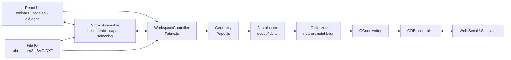

# Arquitectura

OpenBurn es una app **Electron + React + TypeScript** con tres motores principales:

1. **Fabric.js** para el modelo y la edición del lienzo.
2. **Paper.js** para geometría booleana, offset y vectorización de trayectorias.
3. **Controlador GRBL** con transporte Web Serial o simulador.



---

## 1. Capas de la aplicación

| Carpeta | Responsabilidad |
| --- | --- |
| `electron/` | Ventana, IPC (diálogos, fs, assets), permisos Web Serial |
| `src/core/` | `.obrn`, unidades, DXF, acceso a archivos |
| `src/state/` | Store observable + interfaz `WorkspaceApi` |
| `src/workspace/` | `WorkspaceController`: herramientas, selección, historial, zoom, nodos |
| `src/ui/` | Menús, toolbars, paneles, diálogos, iconos |
| `src/geometry/` | Booleanos/offset (Paper.js), tabs |
| `src/gcode/` | Geometría de mecanizado, planificación, optimización y GCode |
| `src/image/` | Ajuste de imagen y vectorización (ImageTracer) |
| `src/text/` | Texto a contornos (opentype.js) |
| `src/serial/` | Transportes y controlador GRBL |
| `src/io/` | Import/export LightBurn |

---

## 2. Estado y controller

- El documento (`OpenBurnDocument`) contiene capas, cama, unidades y la escena serializada.
- `store` es un store observable minimalista (`useSyncExternalStore`) con el estado de UI: herramienta activa, selección, zoom, cursor, dispositivo, etc.
- `WorkspaceController` se registra en `WorkspaceApi` para que la UI invoque comandos imperativos (nuevo, guardar, alinear, booleanos…).
- Cada cambio relevante de la escena se snapshotea para **undo/redo**. Los snapshots excluyen los nodos temporales (`excludeFromExport`).

Las propiedades por objeto viajan con la escena:

```ts
FabricObject.customProperties = ['layerId', 'cutOverride', 'imageAdjust'];
```

---

## 3. Render y coordenadas

- El lienzo de Fabric se dibuja sobre un `<canvas>` de fondo que pinta cama, grid, reglas y origen.
- Ambas capas comparten `viewportTransform`.
- El espacio de trabajo usa **mm** y **Y hacia abajo** (origen arriba-izquierda).
- Al importar LightBurn se aplica `y' = -y` y se normaliza el conjunto.
- Al exportar se invierte con `y_lb = bed.height - y_scene`.

---

## 4. Pipeline de GCode

```
Formas Fabric
   │  (objectContours: toSVG → Paper.js → flatten)
   ▼
Contornos en coordenadas de escena
   │
   ├─ Line: contornos tal cual
   ├─ Fill: scanlines con intersecciones Paper.js
   ├─ Offset Fill: offsets concéntricos (polígonos)
   └─ Image: filas con potencia por punto
   ▼
PlanSegment[]  { rapid | cut, points, feed, power, powers }
   │  (optimizeSegments: vecino más cercano por capa)
   ▼
emitGcode: cabecera, M3/M4, G0/G1, M5, M2
   │  (mapeo de origen)
   ▼
GCode + estadísticas (tiempo, distancia, bounds)
```

- **Preview** consume el mismo `JobPlan`, por lo que trayectorias y tiempos coinciden con el envío.
- Los segmentos raster llevan `powers[]` y emiten `G1 X Y S…` para variar potencia punto a punto.
- El control de flujo del envío usa una ventana de 120 bytes y acks de GRBL.

---

## 5. Comunicación con la máquina

```
UI (Laser/Move/Console)
   → machine (singleton)
     → GrblController lógico
       → Transport
         ├─ WebSerialTransport (navigator.serial)
         └─ MockTransport (simulador con tiempos)
```

- `machine` mantiene estado observable: conexión, `MPos`, feed, spindle, trabajo, progreso y logs.
- Polling de estado cada 250 ms (`?`).
- Pausa/resume con `!`/`~`; stop con feed hold + soft reset (`Ctrl+X`).
- En Electron, el proceso principal concede permisos Web Serial y selecciona el puerto.

---

## 6. Texto e imágenes

- **Texto a contornos**: opentype.js carga Inter (fetch en dev, IPC en producción), reconstruye líneas/alineación/rotación con la matriz de Fabric y devuelve un `pathData` en escena.
- **Adjust Image**: `applyImageAdjust` se comparte entre el rasterizador y la previsualización para que el resultado sea idéntico.
- **Trace Image**: se dibuja la imagen a ≤700 px, se cuantiza (mono/color) y se pasa a ImageTracer; el SVG resultante se importa con Fabric y se ajusta al rectángulo original.

---

## 7. Import/export LightBurn

`src/io/lightburn.ts` implementa:

- **Parser XML** con `DOMParser`.
- Soporte de `Rect`, `Ellipse`, `Polygon`, `Path`, `Group`, `Text` (`BackupPath`), `Bitmap` y `CutSetting`.
- Lectura de `VertList` compacto y `<V>/<P>` legado, incluidos handles Bézier y plantillas `VertID/PrimID`.
- **Serializer** que escribe XML legado o compacto, con contornos en coordenadas absolutas, texto en contornos y bitmaps base64.

No usa el código de LightBurn; se basa en el formato XML y en archivos de ejemplo reales.

---

## 8. Pruebas

- Tipos: `npm run typecheck`.
- Build: `npm run build` (renderer + Electron).
- Pruebas funcionales manuales con Chrome headless/Puppeteer durante el desarrollo:
  - creación/transformación de formas,
  - booleanos/offset/tabs,
  - ajuste/trace,
  - round-trip de `.obrn` y `.lbrn2`,
  - jobs contra el simulador GRBL (pause/resume/stop).
- La carpeta de tests automatizados está pendiente de incorporar al repo (ver [TODO.md](../TODO.md)).
