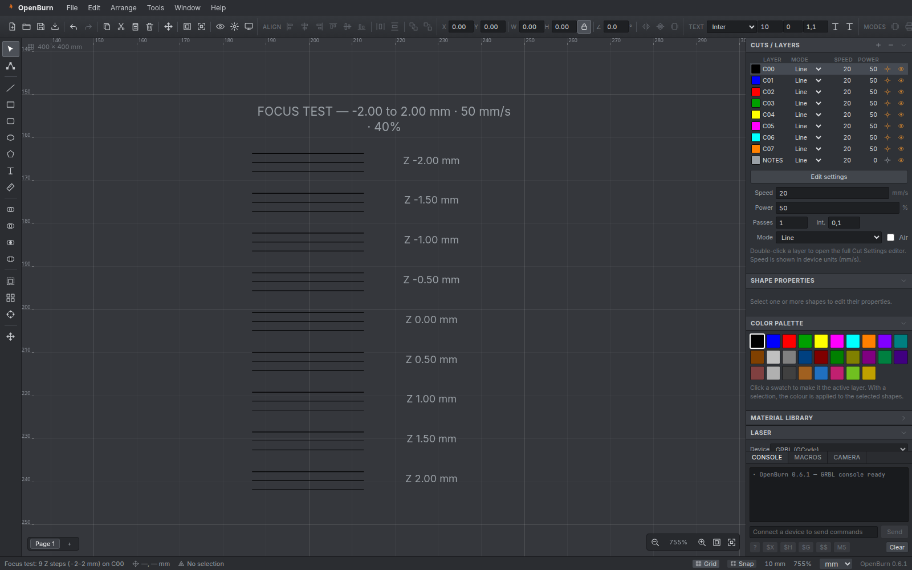
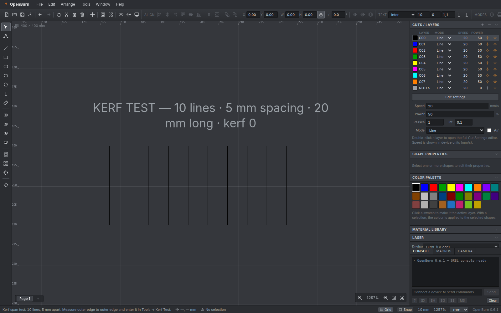

# Guía de uso

Esta guía cubre el flujo completo: diseñar, asignar capas, previsualizar, calibrar y enviar un trabajo a una máquina GRBL.

> Atajos completos en el [README](../README.md#️-atajos-principales).

---

## 1. Workspace

- **Cama**: tamaño configurable en *Settings → Workspace* (mm o pulgadas). El origen se dibuja en la esquina superior izquierda del lienzo.
- **Grid y snap**: toggles en la barra de estado. El tamaño de grid se cambia en *Settings*.
- **Zoom**: rueda del ratón, botones de la esquina inferior derecha, `Ctrl+0` (página), `Ctrl+Shift+A` (selección) y `+` / `-`.
- **Paneo**: `Espacio` + arrastrar o botón central del ratón.

---

## 2. Crear y editar

| Herramienta | Atajo | Nota |
| --- | --- | --- |
| Seleccionar | `S` | Mover/escalar/rotar con controles |
| Nodos | `N` | Requiere un trazado; arrastra anclas |
| Línea | `L` | Arrastrar de inicio a fin |
| Rectángulo | `R` | `Shift` mantiene proporciones |
| Rect. redondeado | — | Radio fijo inicial de 3 mm |
| Elipse | `E` | Arrastrar desde la esquina |
| Polígono | `P` | Lados configurables (por defecto 6) |
| Texto | `T` | Clic y escribe; `Esc` termina |
| Medir | `M` | Muestra la longitud en la barra de estado |

- **Booleanos**: selecciona 2+ formas y usa los botones de unión/resta/intersección/exclusión o *Tools*.
- **Offset**: *Tools → Offset Shapes…*; positivo expande, negativo contrae.
- **Arrays**: *Tools → Grid Array…* / *Circular Array…*.
- **Nodos**: convierte primero con *Tools → Convert to Path*, activa `N` y arrastra los nodos.
- **Texto a contornos**: *Tools → Convert to Path* sobre un texto. Usa la fuente Inter incluida; si el texto usaba otra familia, la barra de estado lo indica.
- **Tabs**: *Tools → Add Tabs…* deja huecos en el contorno para que la pieza no se suelte. Usa modo **Line**.

---

## 3. Capas y ajustes de corte

Cada color de la paleta es una capa (C00, C01, …).

- Haz clic en un swatch para activar la capa; con una selección, el color se aplica a las formas.
- En **Cuts / Layers**:
  - **Mode**: `Line` (contorno), `Fill` (relleno por scanlines), `Offset Fill` (relleno concéntrico), `Image` (raster).
  - **Speed** (mm/s), **Power** (%), **Passes**, **Interval** (mm).
  - **Output**: si la capa se envía al láser.
  - **Eye**: visibilidad en el editor (no afecta la salida).
- Doble clic en una fila abre el **Cut Settings** completo (offset, overscan, dither, air assist).
- **Material Library** (panel derecho): presets rápidos de velocidad/potencia.

> El orden de las capas en la lista es el orden de ejecución: graba primero y corta al final.

---

## 4. Preview y GCode

- **Preview** (`Alt+P`) abre la simulación: trayectorias por capa, recorridos, cabeza láser, tiempo estimado y longitud de corte.
- Controles: play/pausa, scrub, velocidad (1×–60×), mostrar *travel*.
- **Send to laser** envía el plan si hay una máquina conectada.
- *File → Export GCode…* (`Ctrl+E`) guarda un `.nc`.
- **Optimización**: *Settings → Optimize travel* reordena segmentos por capa para minimizar viajes. Desactívala si necesitas el orden original de las formas.

> El GCode usa `G21/G90`, `M3`/`M4`, `M5` entre desplazamientos y `M2` al final. El origen (bottom-left/top-left) se configura en *Settings → Machine*.

---

## 5. Conectar una máquina GRBL

1. Panel **Laser** → **Port**:
   - **Ask on connect…**: pide permiso Web Serial y abre el puerto.
   - **Simulator (demo)**: no requiere hardware; simula estados, oks y tiempos.
2. Pulsa **Connect**.
3. Verás estado (`Idle`, `Run`, `Hold`, `Alarm`), `MPos`, feed y spindle.

### Trabajo
- **Frame**: mueve el cabezal alrededor de la selección (láser apagado, `S0`).
- **Start**: genera el plan y lo transmite con control de flujo.
- **Pause/Resume**: `!` / `~` (feed hold).
- **Stop**: feed hold + soft reset (`Ctrl+X`), limpia la cola.
- **Cut selected graphics**: envía solo la selección.

### Move
- Jog por pasos (`$J`), **Home** (`$H`), **Unlock** (`$X`), **Origin** (`G10 L20 P1 X0 Y0`).
- Ajusta **Step** y **Feed**.

### Consola y macros
- La consola muestra comandos enviados/recibidos. Envía comandos manuales (solo con la máquina conectada e inactiva).
- Botones rápidos: `?`, `$X`, `$H`, `$G`, `$$`, `M5`.
- **Macros**: crea, edita y ejecuta secuencias de GCode. Se guardan en `localStorage`.

### Seguridad
- El láser puede encenderse durante un trabajo. Usa gafas adecuadas, ventilación y supervisión.
- El simulador es la forma recomendada de probar el flujo antes de conectar hardware.

---

## 6. Tests de calibración

### Material Test
*Tools → Material Test…*

- Potencia mín/máx/pasos y velocidad mín/máx/pasos.
- Crea una matriz de celdas (potencia × velocidad) en la capa activa.
- Por defecto cada celda lleva un **override** de velocidad/potencia; el resto de la capa no se altera.
- Opción **Create one sublayer per cell**: crea una capa real por celda (nombre `C00 P40 S50`), con velocidad y potencia en sus ajustes. Útil para conservar ambos valores al exportar a LightBurn y para ajustar cada celda desde *Cuts / Layers*.
- Las etiquetas (`S…/P…`) y la cabecera van a una capa **NOTES** con *Output* desactivado: se ven en el editor pero **no se graban**.
- Al seleccionar el test, *Shape Properties* muestra *“N cut overrides”* y un botón **Clear**.

### Interval Test
*Tools → Interval Test…*: parches de relleno con intervalos crecientes para encontrar el espaciado óptimo.

### Focus Test (eje Z)
*Tools → Focus Test…*

1. Activa **Settings → Machine → Z axis installed** e indica el **Z feed** (mm/min).
2. Define el rango Z (por ejemplo `-2` a `+2` mm), número de pasos, largo de línea y líneas por paso.
3. Pulsa **Create focus ramp**: se crea una rampa de líneas paralelas, cada grupo con su propio `zOffset`.
4. Genera el GCode/Preview: aparecen los `G1 Z…` antes de cada grupo y un retorno a `Z0` al final.
5. Corta en un material de prueba y elige la fila con la línea más fina y oscura. Ese Z es tu foco.

Los valores de Z también se pueden fijar por objeto en **Shape Properties → Z offset** cuando el eje Z está activado.

### Kerf Test
*Tools → Kerf Test…*

1. Elige el método:
   - **Slot**: corta una ranura rectangular de ancho nominal (p. ej. 1 mm) y largo conocido.
   - **Line span**: corta N líneas verticales separadas una distancia fija y mide de borde exterior a borde exterior (más preciso con calibre).
2. El patrón se crea con **kerf 0** y etiquetas en la capa `NOTES`.
3. Córtalo y mide:
   - Slot → ancho real de la ranura.
   - Span → distancia entre el borde exterior de la primera y la última línea.
4. Introduce la medida en el mismo diálogo. OpenBurn calcula:
   - **Slot**: **offset** = (nominal − medido) / 2. Si la ranura sale más ancha que lo nominal, el offset es negativo (contrae el contorno).
   - **Line span**: **full kerf** = medido − span nominal; **offset** = full kerf / 2, con signo según el objetivo:
     - **Outer parts (+)** expande el contorno (piezas exteriores).
     - **Holes / slots (−)** contrae el contorno (agujeros).
5. Pulsa **Apply to active layer**. Si seleccionas un material de la biblioteca, también actualiza su kerf.
6. Para una capa con agujeros y piezas exteriores, duplica la capa y usa offsets opuestos.

### Kerf, ángulo y scan offset
En *Cuts / Layers → (editar capa)*:

- **Kerf** (solo Line): compensa el ancho del haz. Positivo expande los contornos cerrados (piezas exteriores), negativo los contrae (agujeros/ranuras). Ej.: con un ancho de haz de 0,2 mm usa `+0.1` para piezas y `-0.1` para agujeros.
- **Angle** (Fill/Image): dirección del relleno en grados (`0` horizontal, `45` diagonal).
- **Cross-hatch**: añade una segunda pasada a `angle + 90°` para rellenos cruzados.
- **Scan offset**: desplaza las líneas de scan a lo largo de su dirección para compensar el retardo del láser.

### Biblioteca de materiales
*Window → Material Library* (panel derecho):

- Selecciona un material, edita sus valores (incluido **kerf**) y pulsa **Apply to layer**.
- **Save layer** añade la capa activa como material nuevo.
- **Delete** elimina el material seleccionado.
- El **Kerf Test** puede guardar el offset medido directamente en el material seleccionado.
- Los cambios se guardan automáticamente en el navegador/equipo (`localStorage`).

---

## 7. Imágenes

### Importar
*File → Import…* acepta PNG/JPG/GIF/BMP/WebP.

### Adjust Image
*Tools → Adjust Image…*

- Brillo, contraste, gamma, **niveles** (punto negro/blanco) y **curva de tonos** (clic para añadir puntos, arrastra para mover, doble clic para quitarlos).
- Umbral e invertir.
- Previsualización en escala de grises (lo que verá el láser).
- Los ajustes se guardan en el objeto y se aplican en Preview y GCode sin modificar el archivo original.

Para grabar una imagen, la capa debe estar en modo **Image**, con intervalo/potencia/dither adecuados.

### Trace Image
*Tools → Trace Image…*

- **Monochrome**: umbral + contornos.
- **Colour**: cuantización a N colores, con opción **Split colours into separate layers** (crea una capa `Trace #RRGGBB` por color).
- **Preview** en vivo antes de aplicar; se actualiza al cambiar los ajustes.
- Ajusta *path omit* para descartar detalles pequeños.
- El resultado se añade en la capa activa, ajustado al rectángulo de la imagen; la imagen original se conserva.
- Si no te gusta el resultado, `Ctrl+Z` y prueba otro umbral/detalle.

### Apply Mask to Image
*Tools → Apply Mask to Image*

- Selecciona **una imagen** y **una o más formas cerradas** y aplícalo: la imagen queda recortada a la intersección con la máscara.
- La forma de máscara se consume y la imagen enmascarada reemplaza a la original (se conservan capa y ajustes de imagen).

---

## 8. LightBurn: abrir y exportar

### Abrir un proyecto
- *File → Open LightBurn Project…* o *File → Open…* con un `.lbrn`/`.lbrn2`.
- Se importan capas, geometría, texto con contornos de respaldo, bitmaps y ajustes de corte.
- La vista se ajusta al contenido; el nombre del archivo se usa como nombre del documento.

### Exportar
- *File → Export LightBurn (.lbrn)…* — XML legado, fácil de inspeccionar.
- *File → Export LightBurn 2 (.lbrn2)…* — formato compacto actual.
- El texto se exporta como contornos; las imágenes como `Bitmap`.
- Revisa la barra de estado: muestra número de formas y avisos (p. ej., imágenes rotadas).

Detalles técnicos y limitaciones: [FILE-FORMATS.md](FILE-FORMATS.md).

---

## 9. Portapapeles

- **Dentro de OpenBurn**: `Ctrl+C` / `Ctrl+X` / `Ctrl+V` copian y pegan formas; `Alt+V` pega en su sitio (misma posición original).
- **Desde otros programas**: `Ctrl+V` pega:
  - **texto** como un `Textbox` en el centro de la vista,
  - **SVG** (texto, HTML con `<svg>`, o el formato vectorial comprimido de **Inkscape**) como vectores editables,
  - **imágenes** (PNG/JPG) como raster.
- Cuando el portapapeles trae un vector **y** una miniatura raster a la vez (caso típico de Inkscape), tiene prioridad el vector.
- Los SVG pegados/importados se convierten a **solo trazo** (se descarta el relleno original) y se colorean con la capa activa, como el modo *Line* de LightBurn.
- El tamaño físico se respeta: un objeto de 50 mm en Inkscape se pega midiendo 50 mm (se normalizan las unidades `mm`/`cm`/`in`/`pt`, también en el atributo `style`). La barra de estado muestra el tamaño importado.
- El **texto se traza automáticamente** al generar Preview/GCode (con la fuente Inter incluida); no hace falta convertir a trazado.
- En modo **Fill** se respetan los agujeros de las letras y de cualquier vector (regla *even-odd*): se rellena la silueta y queda en blanco el interior de "e", "o", "a", etc. Un path con subpaths anidados (un rectángulo con vectores dentro) se rellena alternando exterior/interior, igual que en LightBurn.
- Si hay formas en el portapapeles interno y quieres pegar lo del sistema, usa **`Ctrl+Shift+V`** o el menú contextual → *Paste from clipboard*.
- **Clic derecho en el lienzo** abre un menú con Cut / Copy / Paste / Paste from clipboard / Duplicate / Delete / Select all.
- **Clic derecho en campos de texto** (consola, ajustes) abre el menú nativo con Undo / Redo / Cut / Copy / Paste / Select all.
- En macOS/Linux, el menú de edición nativo de Electron garantiza los atajos `Cmd/Ctrl+C/V/X` en todos los campos.

## 10. Guardar

| Formato | Uso |
| --- | --- |
| `.obrn` | Proyecto nativo OpenBurn (JSON versionado) |
| `.ovbrn` | Proyecto nativo legado (solo lectura) |
| `.lbrn` / `.lbrn2` | Intercambio con LightBurn |
| `.nc` | GCode para GRBL |
| `.svg` | Intercambio vectorial |

`Ctrl+S` guarda el proyecto nativo `.obrn`. `Ctrl+Shift+S` guarda como.

---

## 11. Problemas comunes

| Síntoma | Solución |
| --- | --- |
| No aparece el puerto serie | Usa Chrome/Electron actualizado; concede permiso Web Serial; o usa el simulador |
| El trabajo no sale | Verifica *Output* en la capa, geometría y que el dispositivo esté conectado |
| El texto no se corta | Convierte a trazado (*Tools → Convert to Path*) |
| El test de material no corta etiquetas | Es intencional: están en la capa `NOTES` sin salida |
| El `.lbrn2` no abre en LightBurn | Revisa la versión y abre un issue con el archivo de ejemplo |
| La imagen sale muy grande | Revisa el tamaño de la cama y el DPI/intervalo de la capa |

---

## 12. Flujo recomendado

1. Diseña o importa (SVG/DXF/LightBurn).
2. Asigna capas y ajustes.
3. Calibra con **Material Test** / **Interval Test** si es un material nuevo.
4. **Preview** para validar trayectorias y tiempos.
5. **Frame** en la máquina.
6. **Start** y supervisa.
7. Guarda el proyecto y el GCode para repetir.
